**YAXCHÉ INDUSTRIES**

# NECOC YAOTL
## Combat Architecture — Director's Cut

**Director: Eduardo Ortiz Quiroz**

- **Proyecto:** Necoc Yaotl  
- **Motor objetivo:** Unreal Engine 5.8  
- **Evento:** Epic AI MegaJam 2026  
- **Estado:** Propuesta arquitectónica pendiente de implementación y validación  
- **Enfoque:** Rally-first  
- **Hito DevLog:** 3 — consolidación de la propuesta arquitectónica

---

## Origen y propósito

Este documento presenta la **propuesta arquitectónica de planificación** del combate de Necoc Yaotl, elaborada para el Hito 3 de la Epic AI MegaJam 2026.

La planificación parte de los **requisitos jugables del proyecto**, especialmente Rally, y define primero sus reglas, invariantes, autoridades y contratos. Sobre esa base organiza las responsabilidades de entrada, entrega, resolución, recursos, reacción y presentación.

Esta es una **propuesta de diseño específica de Necoc Yaotl**. Los nombres de clases y los diagramas expresan decisiones planificadas, no código ya implementado.

La limitación de tiempo de la **Epic AI MegaJam 2026** condicionó las decisiones: minimizar componentes innecesarios, evitar autoridades duplicadas, mantener contratos Fail-Closed verificables por fases y no introducir GAS, EventBus ni FSM duplicadas por preferencia estética.

**Advertencia de estado:** ninguna clase, contrato, Blueprint, DataAsset, Montage, AnimNotify ni integración con Unreal Engine 5.8 se declara implementada, comprobada o funcional en Necoc. Los nombres que aparecen son **nombres conceptuales de diseño**. Las pruebas de §4–§5 son **criterios de aceptación futuros**.

## Filosofía de combate

**Necoc Yaotl es un soulslike de fantasía oscura centrado en la visceralidad, el peligro, el peso de los impactos y la agresividad del combate.**

**Rally** es la piedra angular del diseño: recibir daño genera una oportunidad temporal de recuperación; atacar y conectar impactos efectivos permite convertir Rally en HP permanente. El jugador debe elegir entre retirarse para sobrevivir o arriesgarse a contraatacar y recuperar parte de su salud.

A partir de esta mecánica se definen coherentemente, como **propuesta**:

- Daño, atributos y recursos.
- Ataques, combos y movesets.
- Defensa con arma, bloqueo, parry y contraataques.
- Stamina, movilidad y recuperación de acciones.
- Enemigos, IA y proyectiles.
- Poise, Hyper Armor y reacciones.
- Lock-on, orientación y Motion Warping.
- Hitstop, VFX, SFX y feedback.

**Rally-first** significa **prioridad arquitectónica** del contrato central de daño/recuperación, **no** acoplamiento artificial: cada sistema conserva sus responsabilidades y solo usa los contratos compartidos que le corresponden.

## Principios Rally-first (invariantes propuestas)

Ownership de recursos **no se fragmenta**. Números de balance abiertos.

- Solo jugador posee Rally activo en v1.
- **`UAttributeComponent` es la única autoridad** de `CurrentHealth` y `RallyHealth` (Punto 2). Sin `URallyComponent`.
- La **pérdida real de HP** (`ReceiveDamage` → `AppliedDamage` por impacto en `FCombatHitResult`) alimenta el pool; no el daño solo solicitado ni `FinalDamage` sin aplicar (Punto 1).
- Enemigo→Jugador: Attribute del **jugador** genera Rally. Jugador→Enemigo: Attribute del **enemigo** reporta `AppliedDamage`; el Resolver pide `ConvertRally` al Attribute del **jugador atacante**. Nunca Rally ni Convert en Attribute enemigo.
- Conversión: impactos hostiles con **`Result.AppliedDamage > 0`**, predicado **independiente** de Combat Presence.
- Decaimiento/timeout del pool **dentro** de Attribute (mismo peón que HP).
- Pociones / hoguera: limpian o recortan solapes en la misma autoridad de HP.
- **Defensa (P3):** sin `AShield`; `IBlockableInterface`/`TryBlockHit` + `WeaponDefenseProfile` en el arma; Parry ≠ StanceBreak automático; CounterOpportunity con lifecycle propio.
- **Acciones (P4):** `Intent → Resolve → TryStart → Start*`; inicio seguro; Exhausted diferido; locomoción `LockedInput`/`AllowedScaled`/`DodgeCommit`; cinco conceptos de input; gracia **solo** Dodge; **Contrato F** `UseConsumable` (gema vital, no poción bebible).
- **Armas (P5):** `AWeapon` SoT (bases, trace, AttackConfig, DefenseProfile); snapshot por segmento; teardown MainHand completo; Equip voluntario solo UnOccupied/menú.
- **Enemigos (P6):** HFSM + `UEnemyAttackConfigDataAsset`; PendingAttack; proyectiles Fail-Closed; sin Rally activo.
- **Reacciones (P7):** HP ≠ Poise ≠ react ≠ stun ≠ SB ≠ GB; HA anti-stun only; recovery/PendingHit/same-team/HA teardown.
- **Espacial (P8):** LockOn + orientación por fase + MW snapshot; Walk/Run/Sprint/Jump-Fall-Land; Quickstep/backstep; anim ≠ intención; crouch/vault fuera del slice.
- **Fronteras (§2.11):** inventario/consumibles, interacción, checkpoint, respawn — operaciones mínimas; combate no posee cantidades ni SaveGame.
- **Feedback (P9):** presentación lee `FCombatHitResult`; Hitstop seguro; Anim≠Contacto≠Reacción. Build: **Fase 9**; integral: **Fase 10**.

---

## 1. Arquitectura propuesta de combate (patrones)

### 1.1 Jerarquía de clases y responsabilidades (diseño Necoc)

Árbol **propuesto** (nombres conceptuales; pendiente de implementación y validación en Necoc / UE 5.8):

- `ACharacter`
  - `ABaseCharacter` + `IHitInterface` — `UAttributeComponent`, arma, reacción, knockback, `FPendingHitContext`
    - `AMyCharacter` + `IBlockableInterface` — input/acciones, lock-on, dodge/parry/potion, bloqueo
    - `AEnemy` — HFSM, Poise/StanceBreak
      - `ARangedEnemy` — espaciado, Escape, cancel pre-release
- `Aitem` → `AWeapon` (defensa vía perfil en arma; sin dependencia de escudo para el loop); `ACombatProjectile` → proyectiles concretos
- Componentes: `UAttributeComponent`, `UPlayerLockOnComponent`, HUD health
- Interfaces: `IHitInterface` (`GetHit`), `IBlockableInterface` (`TryBlockHit`)
- Resolución: `FCombatHitResolver`, `CombatHitTypes`, `FCombatTeamHelper`
- DataAssets: Profile → Action/Reaction/Unarmed + RallyConfig; Attack/Combo por arma; EnemyAttackConfig; HitReactionConfig

### 1.2 Capas de responsabilidad

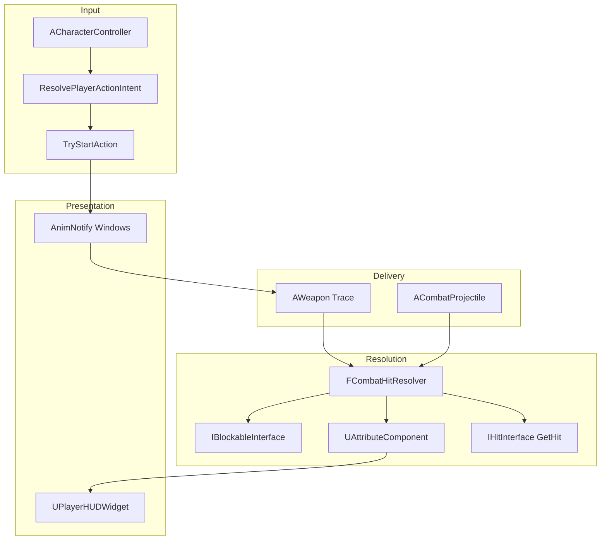

- **Entrada / intención:** `ACharacterController` + resolución de intención en `AMyCharacter` (`StartNow` / `BufferOnce` / `Reject` / `EndHeld`). Sin Priority numérico ni buffer global compartido.
- **Configuración:** Profile DataAsset (Action/Reaction/Unarmed + RallyConfig); AttackConfig por arma. Profile **sin** estado runtime.
- **Entrega:** `AWeapon` / `ACombatProjectile` → `FCombatHitRequest` (daño, poise, stamina de bloqueo, `bCanBeParried`).
- **Resolución:** `FCombatHitResolver::ResolveAndApply` — único borde que aplica daño de combate y orquesta predicados Rally/Presence.
- **Recursos:** `UAttributeComponent` — HP/Rally/stamina (Rally solo jugador).
- **Reacción:** `IHitInterface::GetHit` **después** de mutar HP cuando corresponda.
- **Defensa:** `IBlockableInterface` en el jugador; `TryBlockHit` **antes** de `ApplyDamage`.

### 1.3 Flujo principal (ruta de daño real + ancla Rally)

1. Input → intención → Attack / Sprint / Charged / Combo (`UComboDataAsset`, sections, stamina, poise, Motion Warping).
2. `UAnimNotifyState_WeaponCollision` → trace de arma (barrido anti-ghost).
3. `FCombatHitResolver::ResolveAndApply`:
   - Barrera Encounter Dormant → suprime
   - Filtro de equipo (`FCombatTeamHelper`)
   - `TryBlockHit` (solo cruzado de equipo)
   - `ApplyDamage` → `TakeDamage` → `ReceiveDamage` → **delta = `Result.AppliedDamage`**
   - Poise enemigo; PendingHit + `GetHit`; StanceBreak diferido; Presence (predicado propio)
   - Si predicado Rally de conversión: `ConvertRally` en Attribute del **jugador atacante**
4. Jugador: i-frames / protección pueden rechazar sin `ReceiveDamage` → `AppliedDamage = 0` (sin entrada Rally).
5. Enemigo: Dormant / muerte vía Attribute; **sin** pool Rally.
6. HUD: capas `Current` / `Rally` / `Max` vía `OnHealthLayersChanged`. **`PB_Buffer` (si existe) no es Rally** — solo chase visual opcional.

**Orden contractual:** defensa → pedido `FinalDamage` → rechazo posible en `TakeDamage` → mutación HP → **`AppliedDamage` en Result** → poise → GetHit → SB → Presence → (opcional) ConvertRally. Rally se ancla al **delta real**, no al pedido.

#### Magnitudes de daño (Punto 1)

Capas no intercambiables:

- **IncomingDamage:** snapshot ofensivo de entrega.
- **FinalDamage:** pedido post-mitigación a `ApplyDamage` (**no** equivale a HP realmente perdida).
- **AppliedDamage:** pérdida real de HP de la víctima **de ese impacto**, en su `FCombatHitResult` (sin buffer compartido sobrescribible).
- I-frames / hoguera / Dormant / same-team: `AppliedDamage = 0` según contrato.
- **Presence ≠ predicado de conversión Rally** (Presence puede incluir contacto con daño 0 / block / parry).

### 1.4 Mecánicas satélite (contratos respecto a Rally)

**Ataques y combos** — Intent/`TryStart`/segmentos; ComboWindow ≠ CancelWindow; handoff con id anti-stale; Sprint/Charged como variantes de Attack. Producen snapshots que alimentan Incoming → Applied; **no** escriben Rally.

**Impacto** — `IgnoreActors` por ventana; proyectil one-shot + delivery snapshot. Feedback de contacto tipificado (P9), sin mutar recursos.

**Salud / stamina** — Attribute único mutador de HP/Rally/stamina; Exhausted/overdraw vía P4; Guard Break limpia exhaustion según contrato. Curación jugable = **gema** vía `UseConsumable` (§2.5 F), no `AddHealth` suelto desde input.

**Animaciones / HA** — recovery por EndDelegate + guards; HitReactEnd donde aplique; Hyper Armor Notify+count (anti-stun, no anti-HP/Poise/SB).

**Bloqueo / parry / counter (P3)** — DefenseProfile en arma; parry con poise **parametrizable** (no dump total automático a SB); CounterOpportunity con id; teardown MainHand limpia defensa. Bloqueo parcial → posible `AppliedDamage` → entrada Rally; parry total → 0 → sin entrada; counter que conecta → conversión si Applied>0.

**Esquiva / Quickstep** — gracia direccional exclusiva (§2.5); `DodgeCommit`; backstep si dir=0 (§2.9); i-frames Notify; 8-dir con lock; `CachedMoveInput`. Intención ≠ animación válida de backstep.

**Poise / SB enemigo** — post-`GetHit`; Fail-Closed si falta montage.

### 1.5 Decisiones técnicas

- FSM ligeras jugador/enemigo + helpers de recovery; DataAssets + AnimNotify; Resolver estático; Hit vs Blockable ortogonales.
- Pipeline hit compartido melee/proyectil.
- Acoplamientos aceptados con criterio: Cast del Resolver solo donde un único implementador; HUD a capas, no Percent como contrato Necoc.
- Producto: single-player, sin GAS, sin replicación en el vertical slice.

### 1.6 Assets de Necoc (pendientes)

Blueprints, DataAssets, Montages, IMC y valores de Notify de **Necoc** se validarán en Editor/PIE **cuando se implementen**. Este documento **no** afirma cableados, compatibilidad UE 5.8 ni resultados de PIE. La verificación de estos recursos se contempla como actividad posterior del plan.

---

## 2. Fundamento Rally y contratos de recursos

### 2.1 Por qué Rally no puede ser un parche posterior

- Un `CurrentHealth` escalar sin capa recuperable no expresa el fantasy de Rally.
- Un segundo componente de pool junto a Attribute rompería el invariante `Current+Rally≤Max` y duplicaría clears (Punto 2: alternativa A).
- `OnHealthChanged(Percent)` no distingue permanente vs recuperable; Necoc usa capas.
- `PB_Buffer` (chase visual) **no** es estado de gameplay Rally.
- Usar solo `FinalDamage` como trigger falla con i-frames, overkill y mitigación.
- Presence no define conversión: hace falta `AppliedDamage` + predicado propio en el Resolver.
- Sin daño real (`ReceiveDamage` omitido) → sin entrada al pool (correcto).
- Por tanto F1 fija magnitudes/Attribute y F2 activa la política Rally **antes** de saturar el combate con overlays.

### 2.2 Propiedad y responsabilidades (Rally-first; Puntos 1 y 2)

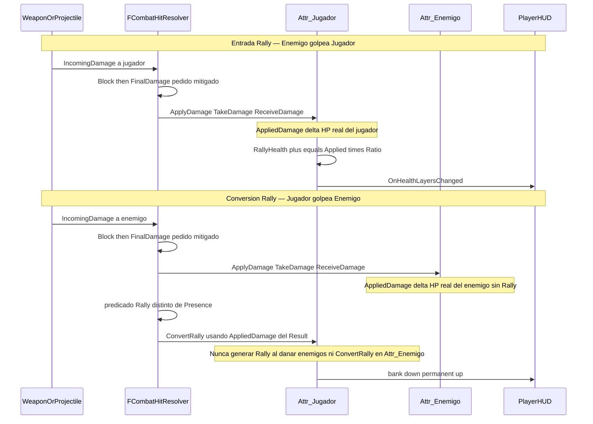

**Decisiones arquitectónicas (aprobadas para el diseño; pendientes de implementación):**

- **Punto 1:** `FinalDamage` = pedido mitigado; `AppliedDamage` = pérdida real de HP; predicado Rally ≠ Presence.
- **Punto 2:** alternativa **A** — Rally **dentro** de `UAttributeComponent`. No introducir `URallyComponent` en el diseño propuesto.

#### Matriz de ownership (Punto 2)

- **`UAttributeComponent` (única autoridad de recursos de vida por peón):** `CurrentHealth`; en **jugador** también `RallyHealth` / `ConvertRally` / decaimiento; cálculo del **delta HP de ese impacto** en `ReceiveDamage`; recorte de pool en `AddHealth`; clear en muerte/`RestoreCheckpointResources`; broadcast `OnHealthLayersChanged`. Invariante jugador: `CurrentHealth + RallyHealth <= MaxHealth`. **Un solo escritor** de las capas de ese peón. Enemigos v1: mismo componente base **sin** Rally activo (no generan ni convierten Rally).
- **`URallyConfigDataAsset` / Profile (solo política):** ratios, duración de ventana, decay, reglas de poción/hoguera. **Sin** estado runtime.
- **`FCombatHitResolver` (orquestación de impactos):** mitiga, pide daño, asocia el delta real de la **víctima** a `FCombatHitResult.AppliedDamage` de **ese** impacto; si predicado de conversión: solicita `ConvertRally` al Attribute del **jugador atacante** (nunca al del enemigo). **No** posee el pool.
- **Personaje (`AMyCharacter` / ciclo de vida):** wiring de config, limpiezas de BeginPlay/muerte/hoguera, estados de acción (Exhausted, i-frames, montages). **No** muta el pool ni duplica timers de Rally.
- **HUD:** consume capas; no es dueño de gameplay.
- **Fuera de alcance v1:** `URallyComponent`, buses de eventos Attribute↔Rally, segundo bind de HUD solo para Rally.

#### Justificación frente a `URallyComponent` (B descartada para v1)

- Attribute es el almacén natural de recursos del peón (`ReceiveDamage`/`AddHealth`/regen/stamina); Lock-On e inventario son **otros bounded contexts**, no capas del mismo `MaxHealth`.
- Cohesión: el invariante de capas de vida exige un escritor; B reparte pool y HP permanente y obliga contratos en cada mutación (poción, regen, checkpoint, muerte).
- Acoplamiento/complejidad: B añade lookup en Resolver, doble clear, riesgo de reentrada `AddHealth`, eventos tardíos duplicados y CDO ruido en enemigos sin beneficio para el vertical slice.
- Prevención de sobreingeniería: **no** crear componente, delegados cruzados ni estado de pool duplicado “para futuro”; delimitar secciones privadas Rally dentro de Attribute y sacar números a DataAsset.

#### Condiciones concretas para extraer Rally a un componente (más adelante)

Solo justificar `URallyComponent` (o equivalente) si ocurre **al menos una**:

1. Rally deja de ser una capa de HP (p. ej. convierte recursos no-vida, o varios dueños distintos de Attribute).
2. Aparece un requisito de autoridad/replicación o multi-peón que prohíba mutar el pool en el mismo objeto que `CurrentHealth`.
3. Las reglas temporales/IA de Rally crecen hasta un dominio propio medible (archivo/tests) **y** el invariante de capas puede preservarse con un contrato único Fail-Closed hacia Attribute — no por preferencia estética de SRP.

Hasta entonces: **A permanece**.

1. **`UAttributeComponent` (fuente de verdad de recursos y de `AppliedDamage`)**
   - Añadir `RallyHealth` (pool recuperable).
   - Invariante: `CurrentHealth + RallyHealth <= MaxHealth`.
   - En `ReceiveDamage`, calcular el **delta real de ese impacto** (`Min(Damage, CurrentHealth)` o pre/post clamp) **antes** de mutar. Ese delta:
     - si el peón es el **jugador víctima**: alimenta `RallyHealth` (× ratio) y refresca la ventana;
     - si el peón es **enemigo**: solo muta HP (sin pool Rally en v1);
     - es la única magnitud confiable de “HP realmente perdida” para ese golpe;
     - **no** se asume igual al retorno de `TakeDamage` / `ApplyDamage`.
   - Daño letal al jugador: tras bajar a 0, limpiar su pool.
   - `ConvertRally(Amount)`: solo en Attribute del **jugador**; pool → `CurrentHealth`. Nunca en Attribute enemigo.
   - `DecayRally` / timeout: solo jugador (estrategia vía config).
   - `AddHealth` (jugador): curación permanente; por defecto **recorta primero el Rally que solapa**.
   - Delegado de capas: `OnHealthLayersChanged(Current, Rally, Max)` — contrato UI Necoc (ver §3).
   - Attribute **no** hace `Cast` a clases de combate para reglas de Rally.

2. **`URallyConfig` / `URallyConfigDataAsset` (o referencia desde `UPlayerCharacterProfileDataAsset`)**
   - Ratio de entrada al pool, duración de ventana, ratio de conversión por impacto (**según `AppliedDamage`**, no `FinalDamage`), decaimiento al timeout, si los golpes refrescan la ventana, políticas de muerte / hoguera / poción.
   - **No** posee estado runtime.

3. **`FCombatHitResult` / Resolver — contrato explícito de magnitudes**
   - Conservar `FinalDamage` = **pedido post-mitigación** a `ApplyDamage` (no es HP aplicada).
   - Cada impacto lleva su propio **`FCombatHitResult.AppliedDamage`**: el delta real de HP de la **víctima de ese golpe**, obtenido en la ruta `ApplyDamage` → `TakeDamage` → `ReceiveDamage` y **asociado a ese Result**.
   - **Prohibido** un `LastAppliedDamage` (u otro buffer compartido) que un segundo impacto pueda sobrescribir antes de leer el primero. La API concreta de reporte por impacto se definirá en el **diseño detallado de Fase 1**.
   - Si `TakeDamage` rechaza (i-frames / hoguera / dormant): `AppliedDamage = 0` en **ese** Result.
   - Same-team / suppressed: sin `ApplyDamage` de combate → `AppliedDamage = 0` en ese Result (sin conversión).

4. **Predicado Rally de conversión (independiente de Combat Presence)**
   - Presence (definición Necoc): `bResolved && !bSuppressed && !bSameTeam` (+ no atacante dormant); puede incluir daño 0 / bloqueo / parry.
   - Rally conversión (Necoc): atacante jugador, objetivo enemigo, `bResolved && !bSuppressed && !bSameTeam`, y **`Result.AppliedDamage > 0`** (Fail-Closed). El Resolver pide `ConvertRally` al Attribute del **jugador atacante** usando esa magnitud (× ratio). **No** generar Rally al dañar enemigos; **no** convertir en Attribute enemigo.
   - Mismo **borde** (Resolver), **predicados distintos**. No escribir Rally en `AWeapon` / `ACombatProjectile` / `GetHit`.

5. **HUD**
   - Capa real de Rally (ProgressBar independiente o tres capas: vacío / Rally / Current).
   - **Prohibido** meter estado de gameplay en `PB_Buffer`.
   - Un solo bind a Attribute / capas; no segundo componente Rally.

6. **Lado personaje**
   - `AMyCharacter` solo enlaza config y limpia en muerte / hoguera / `BeginPlay`.
   - **No** mutar vida dentro de `GetHit`; **no** poseer timer duplicado del pool Rally (el decaimiento vive en Attribute).
   - Enemigos sin lógica Rally activa en v1 (mismo `UAttributeComponent` base, config/ratios nulos).

### 2.3 Contrato de interacción y casos límite

**Entrada al pool (jugador recibe golpe) — siempre vía delta de `ReceiveDamage`:**

- Sin bloqueo, HP baja: pool += `AppliedDamage` × Ratio.
- Bloqueo parcial: `FinalDamage` mitigado llega a `ReceiveDamage` si no hay i-frames → entrada = delta real (no el `IncomingDamage` bruto).
- Parry (`FinalDamage = 0` / `ReceiveDamage(0)`): delta 0 → no entra.
- Dodge / hoguera: `TakeDamage` return 0 sin `ReceiveDamage` → no entra (aunque `FinalDamage` en el Result siga > 0).
- Letal / overkill: entrada solo por HP realmente perdida; luego limpiar pool al morir.

**Conversión (jugador golpea enemigo) — predicado Rally + `Result.AppliedDamage` (delta del Attribute enemigo):**

- `Result.AppliedDamage > 0`: Resolver solicita `ConvertRally` al Attribute del **jugador atacante**; puede refrescar ventana según config.
- Nunca generar Rally ni llamar `ConvertRally` en el Attribute del enemigo.
- Dormant / same-team: no convierte.
- Parry / daño 0 / i-frames del objetivo: `AppliedDamage = 0` en ese Result → no convierte.
- Overkill: convertir según HP quitada al enemigo en ese impacto, no según `FinalDamage` pedido.

**Otras rutas:**

- **Gema / `UseConsumable` → `AddHealth`:** curación permanente + recorte de Rally solapado (solo tras Commit de carga, §2.5 F).
- **`RestoreCheckpointResources`:** vida llena + **limpiar Rally** (+ clear combate, §2.11).
- **Muerte:** limpiar Rally + invalidar acciones/pending (§2.11).
- **GetHit** (incl. same-team): no es autoridad de Rally.

### 2.4 Defensa con arma, Parry/StanceBreak y contraataques (Punto 3)

**Decisiones arquitectónicas (Punto 3)** — sin fijar valores de balance, inmunidades ni condiciones exactas de “cuándo hay counter”:

1. **Sin `AShield` como requisito de defensa.** Adoptar `IBlockableInterface` + `AMyCharacter::TryBlockHit` + orden del Resolver. El arma equipada aporta configuración vía **`WeaponDefenseProfile`** (struct/DA referenciado por el arma): ángulo, multiplicador de bloqueo, costos/cooldown, flags `bCanBlock`/`bCanParry`, poise de parry configurable, referencias de presentación/montages por definir en una fase posterior. `AShield` queda descartado para el loop defensivo de Necoc.
2. **Parry ≠ StanceBreak automático.** El Resolver propuesto aplica poise de parry **parametrizable** (arma × perfil enemigo) vía `ApplyPoiseDamage` + `bPendingStanceBreak` + `ApplyStanceBreak` post-`GetHit` — **sin** dump total automático de Poise. Un parry exitoso puede no romper postura si el poise aplicado no llega a 0. Respuestas por tipo de enemigo = **datos**, una sola ruta de código.
3. **Contraataque = oportunidad independiente** de `ComboWindow` / `bComboInputReceived`. Dueño: personaje. Ejecución: sistema de acciones (`TryStartAction` / SpecialAttack-equivalent). No auto-fire en `TryBlockHit`. No abrir la oportunidad en el Resolver. Condiciones exactas de armado (solo parry, también block, etc.) = **gameplay pendiente**.
4. **`ClearCounterOpportunity` convergente** — único helper de limpieza, enchufado a las mismas familias de call sites que `ClearParryState` / `InterruptParry` / `ResetCombo`, sin segunda red de recovery:
   - interrupción de la defensa origen (`InterruptParry` / `InterruptBlock` / `CleanupInterruptedAction`);
   - fin natural del montage defensivo;
   - impacto con stun / `GetHit` paths;
   - Guard Break / muerte / bonfire protection;
   - agotamiento / preflight que impida continuar (clear explícito; no confiar solo en `HandleExhausted`);
   - cambio o unequip del **arma** que aporta el perfil defensivo;
   - EndPlay / destroy loadout.
5. **Anti-stale con identificador de oportunidad.** Cada oportunidad se vincula a la ejecución defensiva concreta (`CounterOpportunityId` / generation). Callbacks, AnimNotifies y timers deben comprobar el id: un evento antiguo **no** rearma ni reactiva una oportunidad invalidada. Armado solo tras éxito defensivo en el personaje; Notifies **no** arman desde cero (un bool al estilo `OpenComboWindow` / `SetParryActive` **no** basta — carecen del token que sí debe tener `ActiveAttackPlaybackId`).
6. **Equipamiento MainHand/OffHand.** Cambiar/desequipar el arma defensiva (MainHand) debe invalidar block/parry/counter. Fail-Closed si no hay perfil válido.
7. **Stamina / Exhausted.** El contrato del Punto 4 cierra UseStamina-antes-de-estado y Block bajo Exhausted vía CancelWindow (inicio seguro, diferido, materialización en interrupt, re-preflight). Clear explícito de oportunidades defensivas / `ClearCounterOpportunity` en Exhausted paths.
8. **Input vs Dodge (P4/P8).** Block = **acción sostenida** (Started/Completed/Canceled → Press/Hold/Release + `EndHeld`). Parry = **discreta** (Started), **sin** gracia direccional de Quickstep. Counter **no** usa `bComboInputReceived` ni `DodgeDirectionalPending`. La gracia de combinación ≈simultánea es **exclusiva** de Dodge/Quickstep (§2.5 Contrato E); no se generaliza a defensa.
9. **Rally (Puntos 1–2 intactos).** Bloqueo parcial → `AppliedDamage` real → entrada Rally; parry a 0 HP → sin entrada; counter que conecta → conversión con predicado Rally + `AppliedDamage > 0`; Attribute sin lógica de defensa/counter; Presence ortogonal.

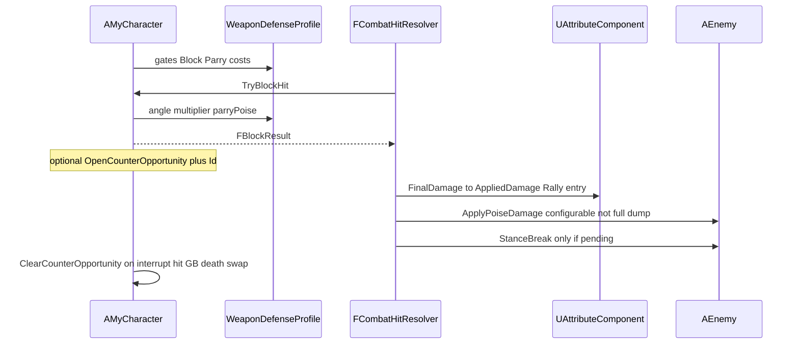

**Gameplay aún no fijado (no congelar en arquitectura):** magnitudes de poise de parry, inmunidades, qué defensas abren counter, montages/VFX definitivos, si el counter exige enemigo en StanceBreak.

**Riesgos Punto 3 a documentar en implementación:** NotifyBegin sin guard; teardown MainHand incompleto respecto a defensa; compartir buffer con combo; abrir counter en Resolver. (Exhausted/Parry orden → ver Punto 4.)

### 2.5 Movilidad, stamina, cancelaciones y recuperación (Punto 4)

**Decisiones arquitectónicas (Punto 4)** — un solo Punto 4; sin subdividir. Sin fijar costos, tiempos, distancias, i-frames, ventanas, multiplicadores ni overdraw definitivo de Parry/Counter:

1. **Adoptar pipeline Intent y FSM ligera.** `Intent → Resolve → TryStart → Start*`, `EActionState` como mutex (Block sigue siendo overlay), helpers propuestos `CleanupInterruptedAction` / `RecoverActionStateAfterMontage` / `RecoverFromAttackMontageEnd`. **Sin GAS, sin Priority numérico, sin segunda FSM.**
2. **ComboWindow ≠ CancelWindow.** Independientes: Combo solo buffer de Attack; Cancel permite Dodge/Parry/Block/Aim con preflight. **`UseConsumable` no cancela Attack por defecto** (solo UnOccupied + excepción Exhausted — Contrato F). Counter **no** usa `bComboInputReceived`.
3. **Stamina en Attribute.** `UAttributeComponent` es autoridad propuesta de stamina (además de HP/Rally). Incluye **overdraw** (`UseStamina`) y **agotamiento diferido** (pending durante acción committed → materializar en recovery).
4. **Inicio seguro (patrón `StartComboSegment`).** Secuencia obligatoria propuesta para acciones committed con montage:
   - preflight sin efectos;
   - cleanup de la acción previa si hay handoff;
   - **re-preflight** post-cleanup (estado + política stamina + ¿puede empezar desde Exhausted?);
   - `Montage_Play` con **comprobación de éxito** (criterio de aceptación; no evidencia actual);
   - commit de `EActionState`;
   - registro de EndDelegate / playback id (callbacks **guardan** ExpectedState o id; no operar sobre init parcial);
   - `UseStamina` según política de la acción (+ Pause/Reset regen según familia).
   - Si falla cualquier paso **antes** del consumo: rollback de montage/estado; **cero** stamina; **cero** pending/timer nuevo; **cero** flags committed huérfanos.
5. **`HandleExhausted`.** En acciones committed compatibles (p. ej. Attacking; Dodge/Parry tras unificar orden): solo pending, **sin** armar timer bajo `UnOccupied`. Timer solo al **materializar** `EAS_Exhausted` en recovery helpers. Guard Break permanece **ruta independiente** (limpia timer/pending; recovery propia).
6. **Interrupt con pending.** Default: materializar `Exhausted` al limpiar la acción interrumpida; luego re-preflight. Handoff no arranca desde Exhausted salvo excepciones documentadas (p. ej. **`UseConsumable`/gema**). **Prohibido** activar Block vía CancelWindow/`TryResumeBlock` bajo Exhausted sin re-preflight.
7. **Cancelación fallida.** El cleanup de la acción anterior puede ser **irreversible**. Si `Start*` de la nueva falla tras cleanup: personaje queda en estado válido (`UnOccupied` o `Exhausted`); sin cobro de la acción fallida; sin timers huérfanos nuevos; sin reabrir la acción interrumpida.
8. **Combo + pending.** Conservar el veto: pending / `ShouldRecoverToExhausted_Attack` **impide** continuación de combo.
9. **Políticas de stamina por tipo de acción (schema).** Configurable por acción/arma (p. ej. RequireFull / AllowOverdrawIfPositive / NoCostOnStart). **Valores definitivos = gameplay pendiente** (incl. overdraw de Parry/Counter y panic-roll post-last-hit).
10. **Política de locomoción por acción (schema).** `Input_Move` se gobierna por política explícita (no por allowlist opaco):
    - `LockedInput` — sin `AddMovementInput` (default Attack/Parry; desplazamiento vía Root Motion / Motion Warping);
    - `AllowedScaled` — input loco permitido × multiplicador (p. ej. Block/Aim); **criterio futuro:** validar con Root Motion en Unreal (evitar doble desplazamiento);
    - `DodgeCommit` — sin loco mid-dodge; **dirección comprometida** al `StartDodge*` (tras gracia/snapshot, §2.9); 8-dir con lock-on.
    La política puede variar por **fase** de la acción (p. ej. recovery con `AllowedScaled` limitado) sin habilitar WASD libre en todo el ataque. Incluye lock-on, CachedMoveInput, Root Motion y Motion Warping en el diseño.
11. **Counter (Punto 3).** `ClearCounterOpportunity` + id anti-stale en las mismas rutas de interrupt/recovery/Exhausted/GB/muerte/swap de arma definidas en §2.4.
12. **Rally (Puntos 1–2 intactos).** Exhausted/movilidad no escriben `RallyHealth` ni redefinen `AppliedDamage` / Presence.
13. **Cinco conceptos de input (generales — todo el combate).** Distinguir formalmente; **no** fusionar en un solo buffer:
    - **Combinación ≈simultánea:** equivalencia de intención direccional dentro de una ventana breve (p. ej. D+X ≈ X+D). **Solo Dodge/Quickstep** usa gracia direccional (Contrato E). **Prohibido** convertir esto en política universal de chords.
    - **Secuencia ordenada:** el orden importa (Light→Heavy ≠ Heavy→Light). Combo / ventanas de ataque; **sin** gracia de dodge.
    - **Acción sostenida:** Block/Aim — Started = Press, hold = estado, Completed/Canceled = Release → `EndHeld`.
    - **Buffer de acciones (`BufferOnce`):** intención durante acción comprometida solo si las reglas lo permiten (p. ej. Attack + ComboWindow). **≠** gracia direccional de dodge.
    - **Cancelación:** interrupción solo en ventana autorizada (`CancelWindow` ≠ `ComboWindow`).
14. **Quickstep / Dodge — gracia direccional (Contrato E, exclusivo).** Ver también §2.9. Pipeline: captura física → (opcional) pending direccional → Resolve → TryStart → StartDodge* → `DodgeCommit` → recovery.

#### Contrato E — Input / Quickstep (Punto 4 + §2.9)

**Alcance exclusivo:** Dodge/Quickstep. No aplica a Attack, Block, Parry, Potion ni Counter.

**Responsabilidades previstas (F3–F4):**

| Capa | Autoridad |
|------|-----------|
| `ACharacterController` | Enhanced Input; actualiza `CachedMoveInput` en Move Triggered; clear en Completed/Canceled; reenvía Dodge **Started** como intent. **No** elige sección, stamina ni `EActionState`. |
| Personaje | Único dueño de `DodgeDirectionalPending` + generation/id; Resolve/TryStart/StartDodge*; commit de dirección; clear pending; recovery. |
| Anim/Data | Selección de sección/montage **después** de resolver dirección; Root Motion = desplazamiento — **no** prueba de que el backstep sea correcto. |

**Estados del pending (no es segunda FSM de combate):** `None` → `DirectionalPending` (intención autorizada, **sin** Dodging/stamina/interrupt aún) → `Committed` vía `StartDodge*` → recovery. Callbacks/timers guardan **generation/id**; eventos stale **no** ejecutan dodge.

**Flujo al Dodge Started:**

1. **Autorización de intención** (`Resolve`): UnOccupied → candidato `StartNow` tras dirección; Attack + `CancelWindow` abierto → candidato a cancel-dodge; else → `Reject`. BUSY fuera de Cancel → `Reject` (sin buffer global de dodge).
2. Si `CachedMoveInput` (o equivalente) **ya ≠ 0** al Started → **inicio inmediato**: consolidación no añade espera; resolver dir → TryStart → StartDodge*.
3. Si Move **= 0** → armar `DodgeDirectionalPending` + `DodgeDirectionalGrace` (configurable, tiempo mundo) + **generation**. **Prohibido** en pending: `UseStamina`, interrupt del Attack/Block, `EAS_Dodging`, Play montage.
4. **Consolidación de dirección (diagonales):** no commitear en el primer eje aislado si puede llegar el segundo casi a la vez. Política breve configurable (`DodgeDirectionConsolidate` ≤ gracia; gameplay abierto). Muestrear/`CachedMove` durante la consolidación; al cierre → vector 2D (incl. diagonales) o cero.
5. Al cerrar gracia/consolidación → **preflight final** → si OK: interrupt acción previa **solo ahora** (si cancel-dodge) → `StartDodge*` (stamina, estado, montage, dirección **inmutable**) → `DodgeCommit`. Si preflight falla → clear pending; **sin** side-effects.
6. X = acción **discreta** (Started). Soltar X **no** cancela `DodgeDirectionalPending`. Held X **no** re-dispara.

**Invalidación legítima del pending (evitar evasiones fantasma):** pérdida de foco / poseer controller; muerte; HitReact/Stun/SB/GB incompatibles; Exhausted que invalide dodge; cierre de lifecycle del personaje; clear explícito en cleanup. **No** invalidar solo por Release de X.

**CancelWindow durante gracia (precisión C):**

| Fase | Regla |
|------|--------|
| Autorización | Se registra al Started si Cancel estaba abierto (o UnOccupied). Guardar `bAuthorizedAsCancelDodge` + generation. |
| Pending | **Sin** interrupt ni stamina. |
| Preflight final | Revalidar: si fue cancel-dodge y Cancel **ya cerró** y el Attack sigue activo → **Reject** / clear pending; **no** interrumpir fuera de ventana. Si UnOccupied (ataque terminó) → puede Start como dodge idle si preflight OK. |
| Commit | Único momento de interrupt + stamina + estado Dodging. |

**Aceptación / rechazo (resumen):**

- D→X / WASD ya presente → dodge direccional inmediato.
- X→D dentro de gracia+consolidación → dodge en D (o diagonal).
- X→D fuera → no redirige dodge committed; si pending expiró a dir=0 → backstep (§2.9).
- X sin Move al resolver → intención backstep.
- BUSY sin Cancel → Reject.
- Recovery UnOccupied → nuevo intent.
- Timer/callback con generation vieja → no-op.

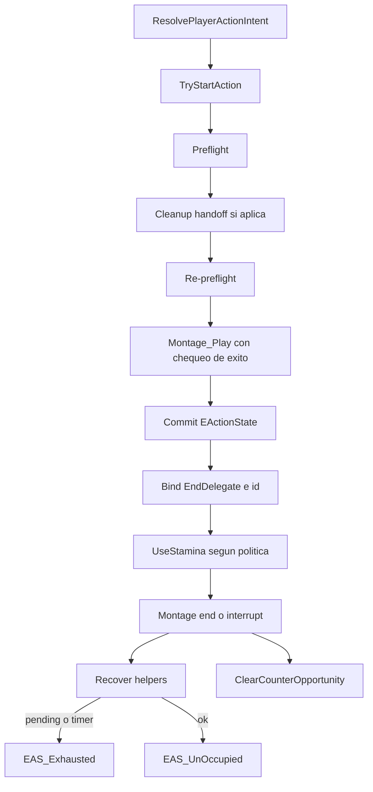

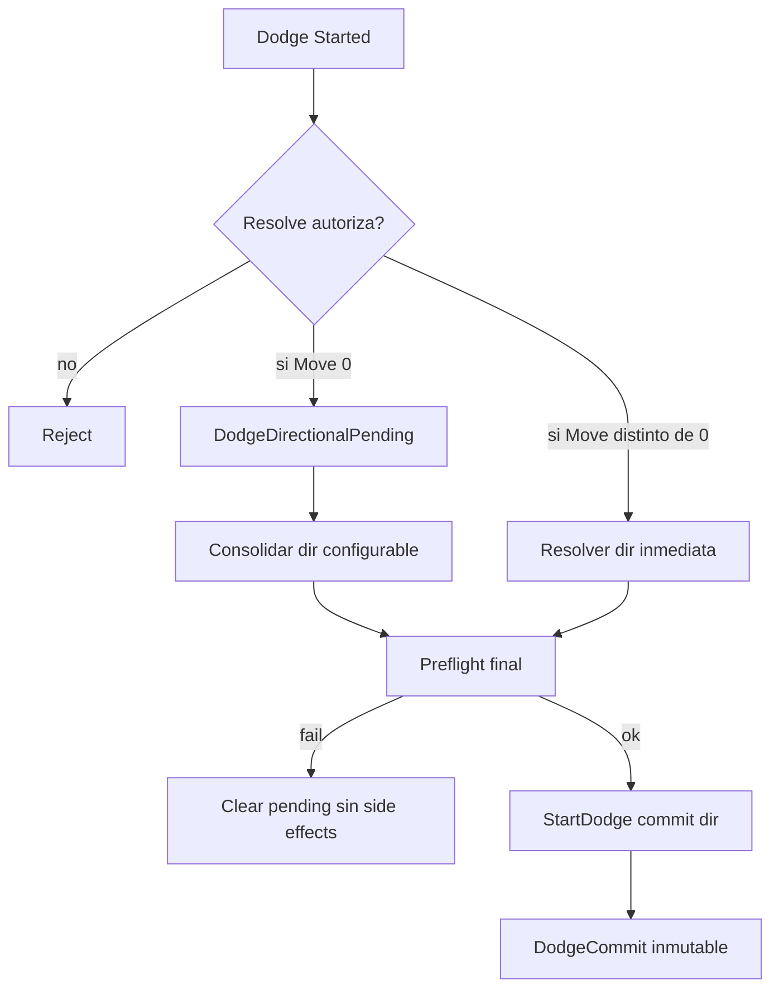

#### Contrato F — `UseConsumable` / gema de energía vital (Punto 4)

**Diseño de Necoc:** el guerrero **no bebe pociones**. Se cura **rompiendo una gema** con la mano (acción rápida, vulnerable, movilidad limitada y recurso consumible). La gema es un **tipo de consumible**, no una arquitectura paralela.

**Pipeline:** `Intent(UseConsumable) → Resolve → TryStart → StartUseConsumable*` — mismo Intent/FSM que el resto. **Sin** GAS, EventBus ni segundo buffer.

**Autoridades:**

| Recurso | Dueño |
|---------|--------|
| Cantidades / defs de gema | Módulo consumibles/inventario (frontera §2.11) |
| HP / Rally | Solo `UAttributeComponent` (`AddHealth` + overlap Rally P2) |
| Acción / montage / generation | Personaje |
| HUD | Lectura: capas Attribute + conteo inventario; **sin** almacén propio de HP/cargas |

**Estados (no segunda FSM):** `None` → autorización → `UsingConsumable` (committed, tras Reserve OK + Play OK) → Apply/Commit en ruptura → recovery. Pending de reserva **antes** de committed no gasta HP ni carga definitiva.

**Defaults MegaJam (configurables en datos, no hardcode de balance):**

- Sin costo de stamina.
- Autorizado desde **`UnOccupied`** y, excepción explícita, **`Exhausted`** (alineado a la excepción Potion previa del P4).
- **No** cancela Attack en curso por defecto (`Resolve` → `Reject` si Attacking).
- Loco: **`AllowedScaled`** durante committed; **Reject** Attack / Block / Parry mientras `UsingConsumable`.
- Dodge/evasión: **antes** de ruptura → interrupt/cancel con Release (sin curar ni Commit); **después** de ruptura → no omitir Recovery ilegalmente con dodge que salte el fin de acción (Reject o solo tras recovery según preflight).
- Nueva curación durante ejecución → `Reject`.
- Hit que provoca interrupt legítimo (P7) puede cancelar la acción.
- HP ya al máximo (`CurrentHealth >= MaxHealth` recuperable): **Reject** por defecto (no gastar gema sin efecto útil). Configurable más adelante; default MegaJam = Reject.

**Operación lógica única en Crush (idempotente; autoridades separadas; sin 2PC/EventBus/FSM nueva):**

Inventario y Attribute siguen siendo dueños distintos. La ruptura es **un solo gate síncrono** de gameplay (mismo Notify/frame, sin latentes ni callbacks externos intercalados).

```text
PREFLIGHT / START
1. Resolve: vivo, estado OK (UnOccupied|Exhausted), no aéreo, CanUse(Gema)
2. HP recuperable? si Current >= Max → Reject (default)
3. Reserve(carga) — falla → Reject
4. Montage_Play — si FALLA tras Reserve → Release inmediato; sin UsingConsumable; sin Commit/AddHealth
5. OK → generation Id + UsingConsumable

NOTIFY CRUSH (único Apply; guarda Id; bEffectApplied==false)
A. Revalidar síncrono ANTES de consumir:
   - personaje vivo / válido
   - Attribute válido
   - Reserve aún vigente
   - generation == montage/acción activa
   - bEffectApplied == false
   - HP aún recuperable (si ya está full → Release; NO Commit; recovery)
   Si cualquier check falla → Release (si reserva viva); NO Commit; NO AddHealth; clear/recovery
B. Commit(carga) — si falla → NO AddHealth; Release si aplica; recovery
C. Commit OK → exactamente un AddHealth(efecto) en el mismo flujo síncrono → bEffectApplied=true
D. VFX/SFX/presentación DESPUÉS: null-safe; NUNCA revierten Commit/AddHealth

POST
Fin montage → recovery P4
Interrupt/muerte/focus ANTES de Crush: Release; sin efecto
Notify Id stale o bEffectApplied: no-op (anti doble Commit/AddHealth)
```

**Garantía MegaJam (single-player):** no consumir definitivamente si el efecto de gameplay no puede ejecutarse. Orden **revalidar → Commit → AddHealth** en el mismo Notify; `AddHealth` sobre Attribute propio del peón se trata como operación local fiable tras los checks A. **No** se declara atomicidad distribuida inexistente. Fallo **solo visual** tras B+C no reembolsa ni repite. Si en implementación `AddHealth` no pudiera invocarse tras Commit válido (Attribute destruido en el mismo instante — caso patológico), compensar con **Release/rollback de Commit del inventario en ese mismo frame** antes de marcar Applied; si el inventario no expone rollback, **no** llamar Commit hasta confirmar Attribute listo para `AddHealth` en el mismo scope (preferido: checks A incluyen Attribute válido + callable).

**Exhausted × cura (Punto 5 consistencia):**

- Cura **no** elimina, reinicia ni “perdona” Exhausted.
- Durante UsingConsumable iniciado desde Exhausted: regen/stamina sigue **política Exhausted** (Attribute + helpers P4).
- Timer/pending Exhausted **no** se cancela al Start cura.
- Al recovery de cura: si Exhausted aún vigente → permanecer Exhausted (o rematerializar según helpers); si el timer venció durante la cura → UnOccupied.
- Interrupt pre-Crush: Release + estado Exhausted coherente.
- Post-Crush: efecto de gema OK; Exhausted sigue si no expiró.
- Una sola autoridad de agotamiento: Attribute + P4.

**Secuencia conceptual (contenido posterior):** solicitar → comprobar → sacar gema → aplastar → en ruptura consumir+aplicar → absorber → recovery. Montages/VFX/duración/magnitud = **gameplay/contenido abierto**.

**Cruces:** ver matriz integral §4. Clear pending cura en muerte, swap incompatible, Exhausted paths que invaliden, EndPlay.

**Gameplay aún no fijado:** costos de stamina (otras acciones); `ExhaustedTime` / regen; distancias/i-frames de dodge; duración Combo/Cancel; valores ms de `DodgeDirectionalGrace` / `DodgeDirectionConsolidate`; overdraw Parry/Counter; panic-roll tras last-hit; multiplicadores de movilidad / `AllowedScaled` de cura; magnitud de curación por gema; montage definitivo de ruptura.

**Riesgos Punto 4 a validar en Unreal:** `AllowedScaled` + Root Motion (doble move); montages sin root motion usable / `MM_Dash` ≠ backstep (§2.9); handoff tras cleanup irreversible; Cancel cierra durante gracia; commit prematuro de eje único (diagonales); pending huérfano tras Release X; Reserve sin Commit/Release; doble Notify Crush; Commit sin Attribute; políticas mal asignadas por fase; Binding de EndDelegate antes de estado committed.

### 2.6 Armas, equipamiento y movesets (Punto 5)

**Decisiones arquitectónicas (Punto 5)** — sin fijar balance, dual wield, montages definitivos ni políticas futuras de hot-swap en combate:

1. **`AWeapon` = SoT de combate del arma equipada.** Posee daño base, Poise base, geometría de trace (`BoxTrace`), referencia a `UAttackConfigDataAsset` (moveset ofensivo, incl. combo vía `UComboDataAsset`) y `WeaponDefenseProfile` (capacidades/parámetros defensivos). Varias armas pueden **compartir** el mismo AttackConfig/Combo DA por referencia.
2. **`UItemDefinitionDataAsset`** = inventario / slot / `RuntimeItemActorClass` / materialización. **No** duplica AttackConfig ni DefenseProfile.
3. **`UPlayerCharacterProfileDataAsset`** = transversal: `ActionConfig` (dodge / UseConsumable-gema / GB + montages block/parry **por defecto**), `ReactionConfig`, opcional **UnarmedAttackConfig**. **No** es el catálogo de movesets de todas las armas.
4. **Resolución:** `GetActiveAttackConfig()` lee MainHand (`EquippedWeapon`); **sin** `switch`/`if` por tipo de arma. Arma equipada sin AttackConfig válido → **Fail-Closed** (rechazar melee). Fallback desarmado **solo** si no hay MainHand **y** existe Unarmed válido. **SprintAttack** = variante opcional en AttackConfig/Combo; **no** obligatoria en el primer vertical slice. Sin config de variante → **Fail-Closed (`Reject`)** — **sin** degradar a Attack Light/otro (§4 alineado). Light/Heavy/Charged = variantes de datos bajo la misma acción `Attack` (sin FSM por tipo).
5. **Autoridad del personaje:** Intent / TryStart / estados / stamina / ventanas / cancel / recovery (Puntos 3–4). Sin `UMovesetComponent` ni subclases por cada estilo cuando bastan DataAssets.
6. **Snapshot ofensivo consistente (por segmento/acción, en el inicio seguro P4).** Al commit de un ataque se fija un contexto coherente mínimo:
   - identidad del arma que inicia (p. ej. ptr/id de instancia);
   - AttackConfig + segmento/special seleccionado;
   - multiplicadores de daño y Poise del moveset;
   - daño/Poise **efectivos** = bases del **mismo** arma × esos multiplicadores.
   `FCombatHitRequest` / traces / Notifies de colisión consumen **ese** contexto (campos runtime del playback propuesto o el mínimo imprescindible en request/contexto). **Prohibido** mezclar bases del arma nueva con multiplicadores de un ataque anterior, o que un Notify/ventana tardía tracee con otra arma. No inventar stats/fórmulas de balance nuevas.
7. **Magnitudes P1 intactas:** ofensiva arma el `IncomingDamage` del request; `FinalDamage` = pedido post-mitigación; `AppliedDamage` = pérdida real de HP; Rally = Puntos 1–2.
8. **Counter — autoridad de animación única:** montage/sección de contraataque en **`UAttackConfigDataAsset`**. `WeaponDefenseProfile` solo gates/parámetros para **permitir** la oportunidad. Personaje: `CounterOpportunityId`, runtime, `ClearCounterOpportunity`, ejecución vía `TryStartAction` + helpers de recovery del Punto 4. **No** duplicar selección de montage de counter en DefenseProfile. Condiciones exactas de armado = gameplay pendiente (P3).
9. **Impacto ≠ recovery:** recovery del atacante = fin/interrupción de montage + helpers P4. **`FCombatHitResolver` no posee ni ejecuta** esa recovery. Whiff / bloqueado / sin WeaponCollision → la acción igual recupera por lifecycle de montage.
10. **Equipamiento / teardown MainHand (cerrado MegaJam):**
    - Cambio **voluntario:** solo **`UnOccupied`** o menú compatible; **Reject** durante cualquier acción committed (Attack/Dodge/Block/Parry/UsingConsumable/HitReact/etc.).
    - Teardown **forzoso** mid-acción: cleanup/recovery propuesto **antes** de destroy/sustituir arma.
    - `InvalidateActiveAttackMontagePlayback()` **solo no basta**.
    - Cerrar Combo/Cancel/ventanas; detener traces (vía stop montage / clear ignore); invalidar ids/callbacks; limpiar block/parry/`ClearCounterOpportunity`; clear `DodgeDirectionalPending` / reserva consumible si aplica; evitar `EAS_Attacking` huérfano, montage con arma destruida, o Notify viejo traceando el arma nueva.
    - Una sola red de recovery (helpers del diseño P4/P5); sin segunda FSM.
11. **Frontera inventario↔arma:** combate consulta slot MainHand / spawn class; **no** implementa UI de inventario ni loot (§2.11).

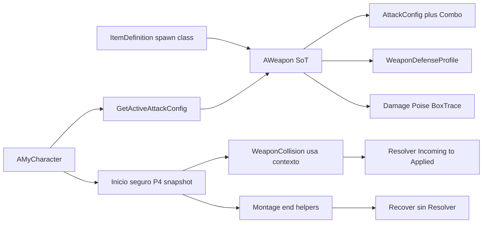

**Gameplay aún no fijado:** números de daño/poise/stamina; montages por arma; dual wield; overrides opcionales de montage block/parry en DefenseProfile; char-stats ofensivos futuros; authoring de variante SprintAttack.

**Riesgos Punto 5:** Invalidate-only en teardown; NotifyCollision sin guard de arma/playback; duplicar AttackConfig en Definition/Profile; counter montage en dos sitios; snapshot incompleto al swap; Equip mid-consumible/dodge.

**Estado:** montages/DA de Necoc = **pendientes de autoría y validación** en Editor/PIE (igual que el resto de esta propuesta).

### 2.7 IA y acciones ofensivas de enemigos (Punto 6)

**Decisiones arquitectónicas (Punto 6)** — sin fijar pesos, distancias, cooldowns, montages, telegraphs, fases de jefe ni coordinación multi-enemigo:

1. **Adoptar HFSM propuesta:** `AEnemy` + `EEnemyState`; **`SetEnemyState`** como único escritor de transiciones (enter/exit limpia pending/ataque/archetype según las rutas del diseño).
2. **Ofensiva IA = `UEnemyAttackConfigDataAsset` / `FEnemyAttackEntry`.** Selección por pesos (`ChooseAttackIntentIndex` / PendingAttack), luego posicionamiento a ventana de distancia, facing/LOS, ejecución. **No** fusionar con `UAttackConfigDataAsset` del jugador (P5): contratos de decisión distintos.
3. **Incluir en el diseño:** histéresis `CombatingRadius + CombatExitBuffer`; cooldowns post-ataque; Weapon Trace / proyectiles / `FCombatHitResolver` / `UAttributeComponent`; `ARangedEnemy` para Escape + cancel LOS **pre-release**.
4. **Élite / jefe:** más entries o DA intercambiables/filtrables por fase — **misma HFSM**; especialización C++ solo si el comportamiento no cabe en datos (como Escape/LOS).
5. **No introducir por defecto:** Behavior Trees, StateTree, GAS, ni `EnemyCombatComponent` / segunda FSM. La IA decide el ataque; el combate compartido resuelve impactos.
6. **Poise ofensivo:** Necoc aplica el **contrato de composición P5** (bases arma × mults del entry) al commit del ataque; no dejar Poise ofensivo desalineado de la configuración del arma/entry.
7. **Enemigos v1 sin Rally activo** (P2). CounterOpportunity sigue siendo del jugador (P3).

**Contrato A — Validez / reevaluación de `PendingAttack`:**

- `PendingAttack` pertenece a la **decisión activa** (índice + marca temporal / flags del diseño), no a un selector paralelo.
- **Invalidar** (clear, sin ejecutar) si: objetivo inválido; estado incompatible (p. ej. sale de familia Combating hacia Searching/Patrolling/Dead/Dormant/Stun/StanceBreak según reglas HFSM); config/entry ya no seleccionable; o la decisión queda **permanentemente no viable** (no confundir con “aún fuera de rango pero posicionable”).
- Si el posicionamiento **no es viable** (timeout / bloqueo de reintento, o imposibilidad demostrable): cancelar o reevaluar vía `ClearPendingAttack` + volver a `OnCombating` / `CheckCombatTarget` / nuevo roll — **sin** segundo selector ni FSM nueva. Conservar selección por pesos.
- Un pending invalidado **no** debe ejecutarse por callback/evento tardío.
- Distancias, timeouts y tolerancias = **gameplay pendiente** (schema/parametría; sin números aquí).

**Contrato B — Inicio seguro y recuperación de ataques enemigos:**

```text
Decisión → Validación → Inicio (snapshot + state) → Montage → Impacto opcional → Recuperación
```

- Fallo de validación o de `Montage_Play`: **no** comprometer ataque; no dejar `EES_Attacking`, mults, ventanas de colisión ni flags activos incorrectos (clear config + `CheckCombatTarget`).
- Interrupción: salir de `EES_Attacking` por `SetEnemyState` / helpers propuestos; limpiar ataque activo; Notifies/EndDelegates tardíos **no** reactivan ataques cancelados ni liberan proyectiles de ejecuciones anteriores.
- **Proyectiles:** release solo si corresponde a la ejecución ofensiva **vigente** (id/token mínimo de ataque o validación equivalente — sin componente nuevo). Proyectil **ya liberado** conserva snapshot de delivery; **no** invalidación retroactiva si el enemigo se interrumpe después.
- Traces activos terminan al interrumpir / morir / abandonar ataque.
- Whiff / sin hit: recovery por **lifecycle de montage** (+ `OnAttackEnd` / end delegate), **nunca** vía Resolver.
- Recovery/limpieza convergente en `SetEnemyState` + helpers del diseño; sin red paralela. `EEnemyState` ≠ `EActionState` (contratos de seguridad equivalentes, FSM distintas).
- **Cooldown al salir de `EES_Attacking`:** **política configurable / gameplay pendiente** — no fijar si interrupt siempre arma cooldown ni sus tiempos (salvo Dead).

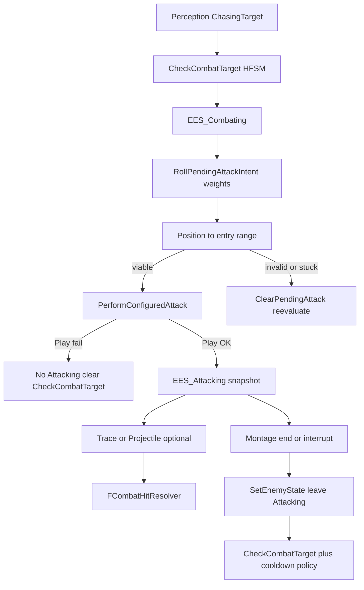

**Estado de la propuesta:** HFSM, PendingAttack, EnemyAttackConfig, PerformConfiguredAttack, Escape/LOS y paths Weapon/Resolver son **contratos de diseño** a implementar en C++. BP enemigos, montages/Notifies, DA authored y `AIControllerClass` = **pendientes de autoría y validación en Editor/PIE de Necoc**. Ninguno se declara funcional hoy.

**Gameplay pendiente:** weights, radios, cooldowns, montages, telegraphs, nº de fases jefe, multi-aggro, política exacta de cooldown tras interrupt.

**Riesgos Punto 6:** pending eterno sin reevaluación; Notify/proyectil stale; Attacking huérfano tras Play fail; poise ofensivo desalineado del arma; cooldown-on-interrupt sin decisión de diseño; asumir BT necesario.

### 2.8 Hit Reactions, Stagger, Poise e Hyper Armor (Punto 7)

**Decisiones arquitectónicas (Punto 7)** — sin fijar Poise del jugador, duraciones de stun, inmunidades especiales, knockback, anti-stun-lock ni balance:

1. **Adoptar:** `IHitInterface` / `GetHit`, `FPendingHitContext`, `UHitReactionConfigDataAsset` (montages + secciones direccionales + Death + StanceBreak enemigo), Hyper Armor via `UAnimNotifyState_HyperArmor` + refcount en `ABaseCharacter`, FSM/helpers de recovery (jugador y enemigo).
2. **Orden Resolver propuesto:** defensa → daño HP → Poise → Cache PendingHit → `GetHit` → Stance Break **diferido**.
3. **Ejes separados:** daño HP (`FinalDamage`/`AppliedDamage`) ≠ daño Poise ≠ reacción visual ≠ stagger/stun ≠ Stance Break ≠ Guard Break ≠ knockback ≠ muerte. Recibir daño **no** implica stun automático.
4. **Poise defensivo v1:** en `AEnemy` (no migrar a Attribute sin necesidad). Poise ofensivo del golpe = snapshot P5. Parry → Poise parametrizable (P3), no SB automático.
5. **Hyper Armor:** evita stun ordinario e interrupción asociada; **no** bloquea HP, Poise ni Stance Break. Knockback/VFX con HA: política abierta.
6. **Sin** componente HitReaction, GAS ni segunda FSM. Stun/SB limpian Counter/PendingAttack/ataques vía helpers P3–P6.

**Contrato A — Recovery obligatoria de Hit Reaction / stun / SB (criterio futuro):**

- Nadie debe permanecer indefinidamente en `EAS_Stunning`, `EES_Stunned` o `EES_StanceBreak` por Notify ausente, Play fallido o interrupt.
- Comprobar reproducción (o Fail-Closed) **antes** de comprometer estados que dependan del montage.
- Recovery vía helpers propuestos (`RecoverActionStateAfterMontage` / `RecoverFromStanceBreak` / `CheckCombatTarget` / equivalentes) con guards anti-callback tardío (ExpectedState / id).
- Si el montage de reacción falla: recovery segura compatible con Exhausted pendiente (P4), muerte, o retorno HFSM enemiga — **sin** red paralela ni doble autoridad de estado.
- Timings concretos = gameplay pendiente.

**Contrato B — Limpieza completa de `FPendingHitContext`:**

- Cada contexto se **consume o invalida** al terminar el intento de procesamiento de GetHit.
- Salidas anticipadas (i-frames/dodge, invuln, muerte temprana, defensa que no usa pending, errores de config) **también** limpian el contexto (incluido early-out de dodge).
- Un pending antiguo **no** altera una reacción posterior.
- Un solo almacén: Resolver **produce**; víctima **consume/limpia**. Sin segundo buffer.

**Contrato C — Same-team (política Necoc por defecto):**

- Impacto same-team: **sin** daño HP, Poise, stun, Stance Break ni knockback de combate.
- Cualquier excepción futura = política de gameplay **explícita**, no efecto colateral del Resolver.
- Filtrar **antes** de efectos incompatibles; usar `FCombatTeamHelper` del diseño.
- Ortogonal a Combat Presence y al predicado Rally (P1).

**Contrato D — Teardown seguro de Hyper Armor:**

- Ventanas HA pertenecen al lifecycle de la acción/montage que las abre.
- Interrupt, muerte, swap/teardown forzoso de arma y destroy deben **invalidar** ventanas correspondientes.
- Los helpers propuestos deben impedir que `HyperArmorCount` quede >0 sin ventana legítima; respetar semántica de contador (no “reset a 0” ciego si otra ventana sigue válida; invalidación por **generación/playback** o drenado simétrico al cerrar la acción).
- Notify/callback antiguos **no** reactivan HA tras invalidar la acción.
- Sin segundo componente ni segunda SoT. Valores de balance HA/knockback abiertos.

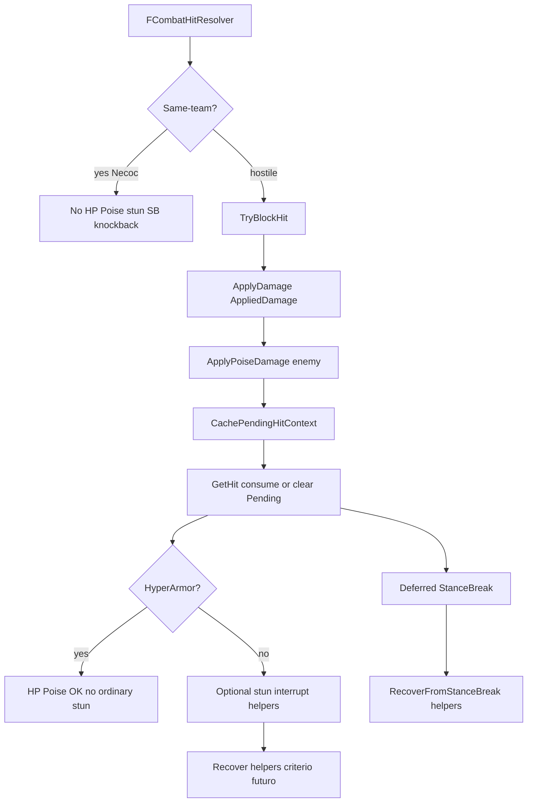

**Estado de la propuesta:** contratos de pipeline/PendingHit/Poise/SB/HA = **diseño pendiente de implementación**; placement de Notifies y valores DA = **Editor/PIE pendiente en Necoc**.

**Gameplay pendiente:** Poise jugador; duraciones stun; inmunidades; knockback; stun-lock; números Poise/HA.

**Riesgos Punto 7:** soft-lock sin HitReactEnd; PendingHit stale tras i-frames; same-team stun accidental; HyperArmorCount huérfano; confundir HA con i-frames/invuln total.

### 2.9 Lock-on, orientación, movimiento y cámara (Punto 8)

**Decisiones arquitectónicas (Punto 8)** — sin fijar radios, ángulos, sensibilidad, velocidades de giro, LOS, WarpStop/MaxWarp ni balance de cámara:

1. **Adoptar:** `UPlayerLockOnComponent` (descubrimiento, score, switch, validez, knobs); `AMyCharacter` orquesta Lock-on / facing / cámara / acciones; `ACharacterController` Enhanced Input + `CachedMoveInput` + gate de Look; `UObstructionRecoverySpringArmComponent` + `UCameraComponent`; dodge 8-dir con lock; free-run / strafe / move libre; `UMotionWarpingComponent` + snapshot espacial `AttackTarget` por segmento (`FPlayerAttackMotionWarpingConfig`).
2. **`Input_Move`:** gate por políticas P4 (`LockedInput` / `AllowedScaled` / `DodgeCommit`) — no allowlist opaco ni segundo locomotor.
3. **Motion Warping v1:** corrige dentro de límites configurables; **no** persigue/alcanza automáticamente al enemigo; sin tracking continuo.
4. **Sin** otro selector de objetivos, CameraManager personalizado, componente de locomoción ni FSM espacial. El sistema espacial **no** es segunda autoridad de daño, Rally, stamina, CounterOpportunity ni HFSM enemiga.

**Contrato A — Validez consistente del objetivo:**

- Una sola política de validez para: adquisición, cambio lateral, mantenimiento, retarget post-muerte y liberación.
- Inválidos: muertos, destruidos, `!IsValid`, o **Encounter Dormant**. Entrar en Dormant mientras está fijado → invalidar.
- Invalidación limpia referencias y marcadores por rutas propuestas (`ClearLockedTarget` / `SetTargetedByPlayer` / `ClearLockOn`); callbacks tardíos **no** restauran un objetivo invalidado.
- No duplicar criterios contradictorios entre `FindBestTarget`, `FindScreenSideTarget` e `IsCurrentTargetValid` (compartir predicado/`IsValidLockOnCandidate`).
- Distancia: histéresis permitida (adquisición vs break radius distintos).
- **Gameplay abierto (no sistema v1 obligatorio):** LOS, ruptura por oclusión, auto-break si el target queda detrás.

**Contrato B — Autoridad única de orientación:**

| Modo / fase | Autoridad |
|-------------|-----------|
| Exploración libre | `CharacterMovement` orienta al movimiento |
| Lock combate (no free-run) | Character face al target; Controller orienta cámara |
| Free-run | Orientación al movimiento |
| Attack committed | Orientación **inicial resuelta en Start*** (inicio seguro espacial); MW solo si config |
| DodgeCommit | Dirección/orientación capturada al start |
| Block / Aim | Facing compatible con su política defensiva |
| HitReact / Stun / SB / Death | Reacciones + helpers tienen **prioridad** sobre facing ordinario de lock |

- Evitar que `bOrientRotationToMovement`, `bUseControllerRotationYaw`, `UpdateLockOnActorFacing`, `SetActorRotation` y Motion Warping peleen la misma rotación sin prioridad explícita.
- **Inicio seguro ofensivo incluye orientación inicial:** no depender solo del facing del Tick anterior (mismo frame Lock-on + Attack). Límites/velocidades de corrección = parámetros de gameplay (no giros ilimitados).
- Adoptar FSM del diseño e `Intent → Resolve → TryStart → Start*`.

**Contrato C — Continuidad espacial durante acciones comprometidas:**

- Al Start de ataque: capturar referencia espacial del **segmento**; MW consume ese snapshot; pérdida de Lock-on mid-montage **no** reorienta el ataque comprometido.
- Muerte/destrucción del target **no** obliga retarget para un ataque ya iniciado.
- Orientación normal se restaura en **recovery**, no en fase committed incompatible.
- Interrupt / stun / muerte / teardown MainHand: limpiar warp targets y restaurar/invalidar autoridades de rotación según helpers; AnimNotify/callbacks tardíos **no** restauran warp de una ejecución anterior (respetar ids de acción/segmento P5 — sin almacén paralelo).
- Filosofía Necoc: MW ≠ homing automático.

**Contrato D — Quickstep / backstep / diagonales (Punto 8 + Contrato E §2.5):**

Capas **separadas** (no fusionar responsabilidades):

1. **Reconocimiento de input** — Controller + `CachedMoveInput` + Dodge Started.
2. **Resolución de dirección** — snapshot inmediato si Move≠0; si no, gracia + consolidación (§2.5 E). Resultado: vector 2D o cero.
3. **Selección de animación/sección** — según dir + lock-on (8-dir / forward / backstep). Fail-Closed si falta sección.
4. **Desplazamiento real** — Root Motion / movimiento del montage elegido. **≠** prueba de corrección del backstep.
5. **Recuperación** — helpers P4; clear pending/generation; restaurar autoridad de orientación.

**Reglas espaciales:**

- Dirección **comprometida** en `StartDodge*`; bajo `DodgeCommit` WASD/X **no** redirigen.
- **Backstep (dir = 0 al resolver):** conservar **orientación del personaje** (no face a cámara/input inexistente). Intención backstep ≠ animación válida.
- **Dependencia de animación (Necoc hoy):** el prototipo usa `MM_Dash`; su Root Motion **no** constituye automáticamente un backstep válido. Hasta existir montage/sección de backstep con RM/desplazamiento correctos, el contrato de **input** puede aceptarse y el de **desplazamiento/orientación de backstep** permanece **PENDIENTE DE VALIDACIÓN MANUAL / assets**.
- **Diagonales:** consolidación breve (§2.5) antes del commit cuando la gracia está activa; sin retraso si WASD ya estaba presente al X.
- Free-run con dir≠0: política de face-al-input en Start según diseño; lock-on: sectores 8-dir relativos al facing del actor.
- Clear de `DodgeDirectionalPending` en las mismas familias de cleanup espacial/acción (muerte, stun, pérdida de foco, EndPlay).

**Contrato G — Ciclo mínimo de locomoción (MegaJam, sin segunda FSM):**

Todo sobre **`UCharacterMovementComponent`** + políticas P4 + autoridad de orientación (Contrato B). **No** StateTree/loco component nuevo.

| Capacidad | Contrato |
|-----------|----------|
| Move WASD + diagonales | `CachedMoveInput` + `AddMovementInput` gated por política de la acción actual |
| Walk / Run | Velocidades CMC / gait; transición por input/speed (datos) |
| Sprint | Held; stamina Attribute; Exhausted P4; **no** Rally. En aire: **inhibir/cancelar** sprint; no iniciar sprint aéreo |
| Jump / Fall / Land | Transiciones CMC; Land restaura gates de loco **sin** pisar HitReact/Death/Exhausted/UsingConsumable prioritarios |
| En aire (Jump/Fall) v1 | **Reject:** Attack, Dodge, Block, Parry, UseConsumable, Equip/Unequip, Counter |
| Durante `UsingConsumable` | `AllowedScaled` (Contrato F) |
| Durante Dodge | `DodgeCommit` |
| Crouch | **FUERA** del vertical slice |
| Vault / obstacle | **FUERA** del slice; futuro vía TryStart sin loco paralelo |

**SprintAttack (§2.6 alineado):** sin variante válida en AttackConfig → **`Reject`**. Sin fallback silencioso a Attack ligero (§4 idéntico).

**Root Motion + locomoción (dependencia P4):**

- `LockedInput` / `AllowedScaled` / `DodgeCommit` como en §2.5.
- **`AllowedScaled` + Root Motion = criterio de aceptación futuro en Unreal Editor** (doble desplazamiento / conflicto de orientación). Montages/AnimBP RM **no** se declaran validados.
- Backstep / `MM_Dash`: ver Contrato D — no asumir funcionalidad por intención sola.
- Multiplicadores, ángulos, radios, velocidades de walk/run/sprint: abiertos (gameplay).

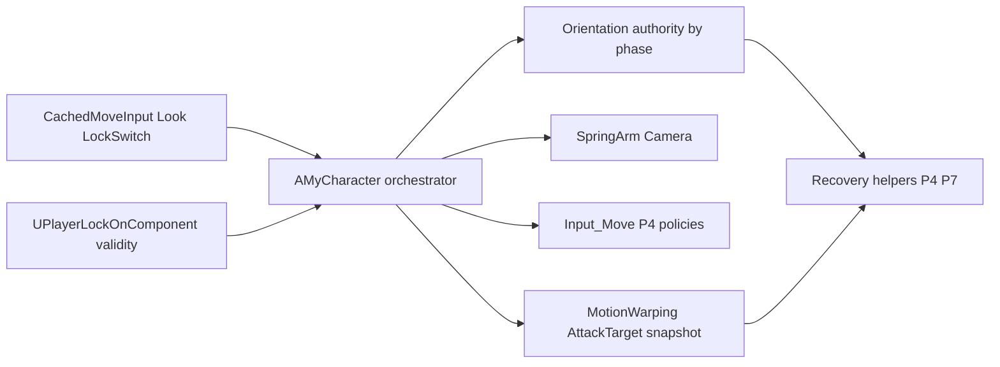

**Estado de la propuesta:** contratos Lock-on/facing/SpringArm/CachedMove/dodge/MW/Quickstep/loco G en diseño; IMC, montages RM (incl. backstep real vs `MM_Dash`), NotifyStates y valores DA = **Editor/PIE pendiente en Necoc**.

**Gameplay pendiente:** LOS/oclusión/break-behind; radios/ángulos/interp; sensibilidad; free-run feel; WarpStop/MaxWarp; FacingTurnRate; ms de gracia/consolidación dodge; asset de backstep; magnitudes sprint/jump.

**Riesgos Punto 8:** validez inconsistente (Dormant fijable); pelea de autoridades de rotación; Attack sin resolve de facing en Start; `AllowedScaled`+RM doble move; warp stale tras interrupt; CameraManager/selector nuevo innecesario; backstep con montage incorrecto; diagonal cortada por commit prematuro; redirect mid-`DodgeCommit`.

### 2.10 Feedback de combate — Hitstop, Camera Shake, VFX y SFX (Punto 9)

**Decisiones arquitectónicas (Punto 9)** — sin fijar assets, duraciones, intensidades ni balance:

1. **Adoptar:** `AWeapon` / `ACombatProjectile` solicitan feedback **atacante** según `FCombatHitResult`; `ABaseCharacter::PlayHitEffects` + `UHitReactionConfigDataAsset` para impacto recibido; `TryBlockHit` + **`WeaponDefenseProfile`** para block/parry (sin `AShield`); Camera Shake / Hitstop con lifecycle seguro (Contrato B).
2. **Resolver** tipifica el resultado de combate; **no** reproduce FX ni controla recovery.
3. **Sin** `UCombatFeedbackComponent`, Event Bus, GAS ni FSM de feedback. Sin nueva autoridad de cámara (P8).
4. **`AppliedDamage = 0` ≠ ausencia automática de contacto** (p. ej. bloqueo total/parry aún son contacto defensivo tipificado).

**Contrato A — Feedback según resultado real:**

| Resultado | Feedback |
|-----------|----------|
| Hit hostil efectivo | Impacto confirmado (víctima + atacante según política) |
| Bloqueo parcial / total | Feedback **defensivo** (no HitEffects normales duplicados) |
| Parry | Feedback específico de parry |
| I-frames | **Sin** Hitstop/Shake de impacto confirmado |
| Same-team / Dormant | **Sin** feedback de combate |
| Hyper Armor | Impacto/daño posibles **sin** stun |
| Whiff | **Sin** efectos de impacto |

- Gatear con Result + datos defensivos ya resueltos; **prohibida** segunda resolución contradictoria en Weapon/Projectile.
- Un contacto: paquete defensivo **o** hit normal, no ambos normales.

**Contrato B — Hitstop seguro ante impactos simultáneos:**

- No restaurar ciegamente `CustomTimeDilation = 1.0`.
- Preservar dilatación previa legítima; coordinar hits superpuestos **por actor afectado** (no solo por arma).
- Un hit nuevo no restaura prematuramente otro Hitstop vigente; timers/callbacks antiguos no mutan generación posterior.
- Interrupt / muerte / teardown MainHand / destroy invalidan **solicitudes propias** sin cancelar Hitstops legítimos de otros atacantes.
- Criterio de aceptación: nadie queda ralentizado de forma permanente.
- Adoptar helpers/clases del diseño; sin manager global sin necesidad. Duraciones/intensidades abiertas.

**Contrato C — Animación ≠ Contacto ≠ Reacción:**

1. **Animación:** whoosh/pasos/movement vía montage/AnimNotify — no requieren hit confirmado.
2. **Contacto:** Hitstop / Shake / FX de resultado Weapon|Projectile + Resolver.
3. **Reacción:** VFX/SFX víctima, block, parry, stun/SB por rutas propuestas.

- Adoptar `IgnoreActors` por ventana y one-shot de proyectil; anti-dupe por contacto; ataques invalidados / callbacks stale sin FX de hit.
- Assets null-safe: falta VFX/SFX **nunca** bloquea daño, recovery ni acciones.
- Presentación **no** muta HP, Rally, stamina, Poise ni estados.

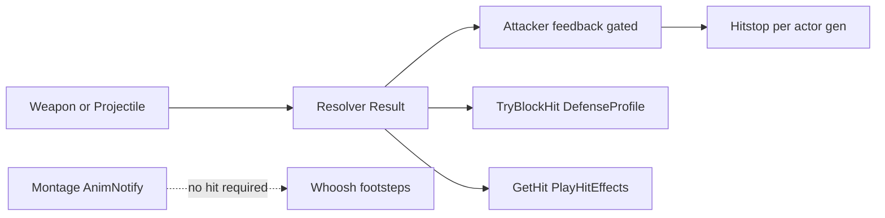

**Estado de la propuesta:** gate Result y Hitstop en diseño; clases Shake y assets VFX/SFX = **Editor/PIE pendiente en Necoc**.

**Gameplay pendiente:** cuándo Hitstop en block/parry/HA; intensidades; FX proyectil vs mundo; Cascade vs Niagara.

**Riesgos Punto 9:** Shake/Hitstop en i-frames/same-team; restore ciego a 1.0; Hitstop huérfano tras destroy; FX duplicados block+hit; FeedbackComponent/EventBus innecesario.

### 2.11 Fronteras externas (inventario, interacción, checkpoint, respawn)

Operaciones **mínimas** para que el núcleo combate/locomoción funcione. **No** diseñan loot UI, economía, SaveGame ni persistencia del mundo.

**Inventario / consumibles**

- `CanUse(ConsumableId)` / `Reserve` / `Commit` / `Release` — dueño: módulo inventario.
- Combate llama la frontera; **nunca** muta conteos locales ni duplica HP.
- Def de efecto (p. ej. heal amount) viene del ítem/def; Attribute aplica `AddHealth`.

**Equipamiento**

- Query MainHand/OffHand / materializar `AWeapon`.
- `RequestEquip` solo UnOccupied/menú (§2.6); sync SoT + teardown P5.

**Interacción**

- Zona de interacción = **propiedad del actor interactuable**, sigue su transform.
- Éxito de pickup → grant al inventario; **no** escribe Attribute ni `EActionState` directamente.
- Si el personaje está committed incompatible → Reject interacción o diferir según módulo mundo (no buffer global de combate).

**HUD**

- HP/Rally: `OnHealthLayersChanged`.
- Cargas de gema / slots: eventos/lectura inventario.
- Sin autoridad de gameplay.

**Checkpoint**

- Mundo solicita `RestoreCheckpointResources` (Attribute: HP lleno, clear Rally, stamina según política) + `ClearCombatTransientState` (acciones, montages, Combo/Cancel, Counter, Dodge pending, Reserve consumible, Exhausted timers según contrato).
- Recuperar control en estado jugable (`UnOccupied` limpio).

**Muerte / respawn**

- Muerte: interrupt acciones; invalidar montages/ids; clear buffers/ventanas/Counter/Dodge pending/Reserve; **Reject** nuevos Attack/Cura/Dodge; limpia Rally (P2).
- Respawn (sistema externo): garantiza pawn sin acciones/callbacks previos; re-enable input tras ready; no reutiliza generation antiguas.

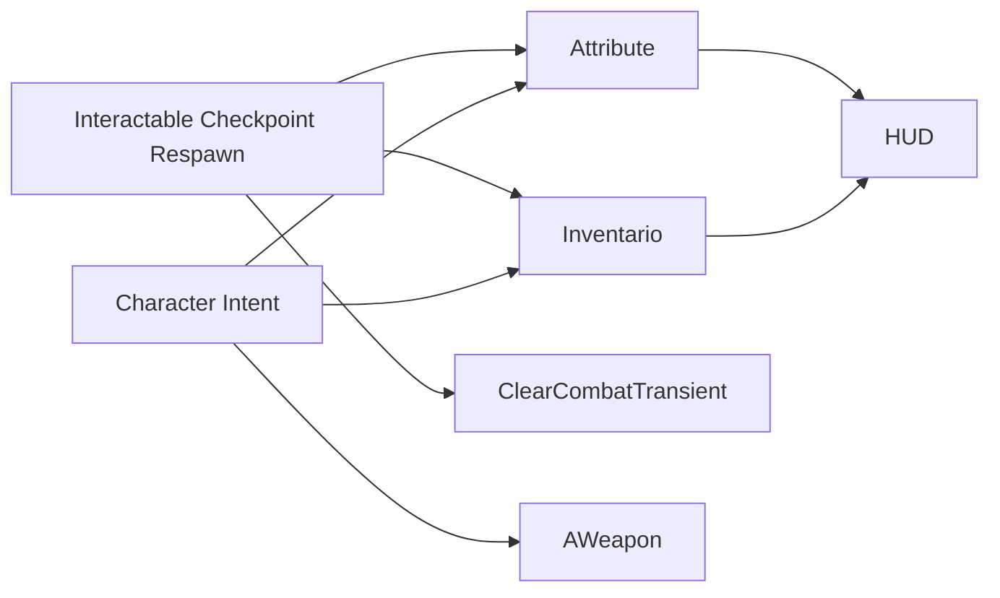

---

## 3. Patrones adoptados / adaptaciones / exclusiones (propuesta Necoc Yaotl · UE 5.8)

Los nombres siguientes son **contratos de diseño**. Su presencia aquí **no** implica código, Blueprints ni compatibilidad UE 5.8 ya validados en Necoc.

### Adoptar (patrones y fronteras)

- Separación entrega / resolución: `FCombatHitRequest` / `FCombatHitResult` / Resolver estático.
- Intención antes de ejecución en acciones del jugador (sin GAS, sin carrera de Priority, sin segunda FSM).
- Árbol Profile DataAsset + contrato de ventanas AnimNotify (con **guards/id** más estrictos para oportunidades que el bool puro de ComboWindow).
- Interfaces Hit / Blockable ortogonales; `FPendingHitContext`; `UHitReactionConfigDataAsset`; Hyper Armor Notify+refcount; Poise enemigo con StanceBreak diferido post-`GetHit`.
- Helpers `CleanupInterruptedAction` / `InterruptParry` / `ResetCombo` / playback id de ataque como modelo de anti-stale e inicio seguro.
- ComboWindow / CancelWindow independientes; CachedMoveInput + dodge 8-dir + lock-on; Root Motion / Motion Warping de ataque (snapshot, no tracking).
- Cinco conceptos de input; gracia direccional **solo** Dodge/Quickstep (`DodgeDirectionalPending` + consolidación + generation); `BufferOnce` ≠ gracia; Block held ≠ Dodge discreto.
- `UseConsumable` gema vital (Contrato F): Reserve/Commit/Release; Commit→AddHealth; Exhausted excepción; sin cancel Attack por defecto.
- Loco mínimo Walk/Run/Sprint/Jump-Fall-Land (Contrato G); en aire Reject Atk/Dodge/Block/Parry/Cura/Equip/Counter; sprint aéreo inhibido; crouch/vault fuera de slice.
- SprintAttack: Fail-Closed sin variante DA (sin fallback Attack).
- Fronteras §2.11 inventario/interact/checkpoint/respawn.
- `UPlayerLockOnComponent` + SpringArm/Camera + `UObstructionRecoverySpringArmComponent` + `UMotionWarpingComponent` (sin CameraManager/selector nuevos); Quickstep/backstep Contrato D (§2.9).
- Feedback: `PlayHitEffects` / ReactionConfig; Hitstop+Shake en arma; IgnoreActors; one-shot proyectil (sin FeedbackComponent).
- `UAttackConfigDataAsset` / `UComboDataAsset` / materialización MainHand–OffHand / `AWeapon` trace (**SoT de moveset en el arma**).
- HFSM `AEnemy` / `EEnemyState` / `SetEnemyState` / PendingAttack / `UEnemyAttackConfigDataAsset` / `ARangedEnemy` Escape+LOS; Weapon Trace y proyectiles enemigos vía Resolver.
- Contratos Exhaustion (overdraw + diferido) / GuardBreak / Dodge invuln (Rally vive en capa de recursos, **no** nuevo `EActionState` solo por Rally).

### Adaptar en la implementación Necoc (futura)

- `UAttributeComponent`: vida en capas + `AppliedDamage` + conversión/decaimiento (Puntos 1–2) + autoridad de stamina (Punto 4); enemigos **sin** Rally activo v1.
- `FCombatHitResult`: `FinalDamage` vs `AppliedDamage`.
- `AWeapon`: SoT combate jugador (bases, trace, `AttackConfig`, `WeaponDefenseProfile`); snapshot ofensivo al Start (Punto 5); enemigos usan arma + **EnemyAttackConfig** (mults/entry) con composición Poise alineada a P5.
- `ItemDefinition`: solo inventario/spawn class; sin copia de moveset/defensa.
- Defensa: `TryBlockHit` lee DefenseProfile del arma, no `EquippedShield`.
- Resolver: poise de parry configurable (no dump total); predicado Rally independiente de Presence; **sin** poseer CounterOpportunity ni recovery de atacante (jugador u enemigo).
- Personaje: `GetActiveAttackConfig()`; inicio seguro Play→estado→Use; re-preflight; Counter id/clear; teardown MainHand = cleanup completo (no solo Invalidate); `HandleExhausted` diferido unificado.
- Counter montage desde AttackConfig; DefenseProfile solo gates (Punto 5).
- Enemigo: invalidación/reevaluación de PendingAttack; inicio seguro ataque; token mínimo anti-stale en release de proyectil; cooldown-on-interrupt = política pendiente (Punto 6).
- Reacciones (Punto 7): recovery obligatoria stun/SB (criterio futuro); PendingHit siempre consumido/limpiado; same-team sin efectos de combate por defecto; HyperArmor teardown en interrupt/muerte/swap; HA ≠ i-frames.
- Espacial (Punto 8): predicado único de validez Lock-on (excluye Dormant); autoridad de orientación por modo/fase; inicio seguro ofensivo resuelve facing; MW snapshot + clear en interrupt/teardown; `Input_Move` por políticas P4; Quickstep/backstep Contrato D (facing en backstep; `MM_Dash` ≠ backstep automático).
- Acciones (Punto 4): Contrato E Quickstep (gracia exclusiva; pending sin stamina/interrupt; Release X no cancela; Cancel×gracia; consolidación diagonal).
- Feedback (Punto 9): gate atacante por `FCombatHitResult` (no FX ciego post-Resolve); block/parry FX en DefenseProfile; Hitstop por actor+generación; Anim≠Contacto≠Reacción; null-safe.
- `Input_Move`: gate por **política de locomoción** (no allowlist fijo opaco).
- Action config: schema políticas stamina + locomoción (valores abiertos).
- `UPlayerHUDWidget`: capas desde Attribute vía `OnHealthLayersChanged`.
- Profile: `ActionConfig` / `ReactionConfig` / Unarmed + `RallyConfig` — **no** AttackConfig de cada arma.

**Criterio de acoplamiento del Resolver (`Cast` a tipos concretos — §1.5):** no rediseñar `FCombatHitResolver` ni inventar interfaces “por higiene”. Criterio:

- **Permitir `Cast` / tipo concreto** cuando la responsabilidad sea exclusiva de esa clase y no haya un segundo implementador previsto en el vertical slice (p. ej. Poise / StanceBreak / Encounter Dormant en `AEnemy`; refresh de Combat Presence en `AMyCharacter`). Un wrapper de interfaz con un solo implementador no reduce acoplamiento real.
- **Usar interfaces del diseño** cuando el contrato ya sea ortogonal y multi-consumidor (`IHitInterface`, `IBlockableInterface`). No añadir `IPoiseable` / `IPresenceSource` (ni equivalentes) solo para ocultar `Cast` del Resolver.
- **Extraer interfaz más adelante** solo si aparece un segundo tipo real que deba compartir esa API **y** el Resolver deba tratarlos de forma uniforme Fail-Closed — no por preferencia estética.

**Delegados de salud / HUD (`OnHealthChanged` vs `OnHealthLayersChanged`):**

- **Una sola autoridad** de HP/Rally en Attribute; **sin** estado duplicado ni doble emisión permanente Percent + capas.
- Contrato Necoc: los consumidores de HUD se enlazan a **`OnHealthLayersChanged(Current, Rally, Max)`**. Si hace falta un percent visual, se **deriva en UI** (`Current/Max`), no con un segundo almacén.
- `OnHealthChanged(float Percent)` **no** es el contrato de Necoc; no mantener dual-broadcast Percent + capas.

### Excluir / no adoptar

- Dependencia de `AShield` / OffHand para block/parry: **descartada**.
- Parry → dump total de Poise → StanceBreak siempre: **descartado**; parametrizar.
- Oportunidades sin id anti-stale: **inseguro**.
- Teardown MainHand incompleto (solo Invalidate): **insuficiente**; cleanup/recovery (Punto 5).
- UseStamina antes de estado committed; Block bajo Exhausted vía CancelWindow sin re-preflight: **prohibido** (Punto 4).
- `URallyComponent` en v1: descartado (Punto 2).
- Meter Rally en `PB_Buffer` / `GetHit`, Counter en Resolver, o WASD libre en todo Attack: romper fronteras del diseño.
- Interfaces nuevas solo para ocultar `Cast`, dual-broadcast HUD, MovesetComponent, montage de counter duplicado en DefenseProfile: descartado.
- BT / StateTree / GAS / EnemyCombatComponent por defecto, o fusionar EnemyAttackConfig con AttackConfig del jugador: descartado.
- PendingAttack eterno sin invalidación, o recovery enemiga vía Resolver: romper Punto 6.
- Soft-lock stun; PendingHit stale; same-team con efectos; HyperArmorCount huérfano; HA como i-frames: romper Punto 7.
- Componente HitReaction / 2ª FSM / GAS: descartado.
- Lock-on a Dormant; pelea de rotaciones; Attack sin facing en Start; `AllowedScaled`+RM sin validar; warp stale; CameraManager/selector/locomotor nuevo: romper Punto 8.
- Hitstop/Shake en i-frames/same-team; restore ciego a 1.0; FX block+hit duplicados; FeedbackComponent/EventBus: romper Punto 9.

---

## 4. Resumen de planificación arquitectónica (Necoc Yaotl)

**Objetivo (pendiente de Build):** vertical slice **Rally-first** — Attribute/`AppliedDamage`/Rally como fundamento; luego armas, defensa, acciones, enemigos, reacciones, espacial y feedback tipificado — sin confundir HP, Poise, stun, SB, Presence, Rally, recovery, facing/MW ni presentación con el Resolver.

**API / contratos públicos sugeridos:**

- Attribute: `ReceiveDamage` → `AppliedDamage` / `ConvertRally` / capas HUD; stamina; enemigos sin Rally v1
- Arma / moveset / DefenseProfile / Counter (Puntos 3–5)
- Acciones jugador + Exhausted + políticas loco (Punto 4); enemigo HFSM + EnemyAttackConfig (Punto 6)
- Hit: `FinalDamage` + `AppliedDamage`; PendingHit produce/consume; HitReactionConfig; HyperArmor count; Poise en `AEnemy` v1
- Resolver: orden defensa→HP→Poise→GetHit→SB diferido; same-team Fail-Closed; predicado Rally ≠ Presence
- Espacial (Punto 8): LockOn validez única; orientación por fase; MW snapshot `AttackTarget`; SpringArm+Camera
- Feedback (Punto 9): gate Result; Hitstop seguro; DefenseProfile/ReactionConfig FX; Anim≠Contacto≠Reacción
- Config schema locomoción/stamina; RallyConfig + HUD capas

**Dependencias (orden de Build):** F1 fundamento → F2 Rally → F3 acciones → F4 espacial → F5 armas → F6 defensa → F7 enemigos → F8 reacciones → **F9 feedback (Punto 9)** → **F10 comprobación integral**; verificación opcional de assets Necoc en Editor. La numeración de Puntos no impone el orden general; F9 entrega el Punto 9 y F10 es la integral. Detalle: §5.

**Matriz integral acción × estado (contrato de implementación — no evidencia de PIE).**

Once dimensiones cubiertas entre tabla resumen + tablas complementarias A–D (sin contradecir §2): Intent/estados | Preflight/recursos | Autoridad | Loco/orient | Ventanas | Interrupt | Apply | Reject | Recovery | Clear (muerte/swap/fail) | Notas.

#### Resumen

| Acción | Estados OK | Apply / recursos | Loco | Reject clave |
|--------|------------|------------------|------|--------------|
| Move Walk/Run | UnOcc, Exhausted, UsingConsumable scaled, Block/Aim pol. | — | CachedMove+pol | — |
| Sprint | UnOcc (+gates); no aire | Stamina | CMC | Aire; Exhausted |
| Jump/Fall/Land | UnOcc (v1 start jump) | — | CMC | Ver aéreas |
| Dodge/QS/Backstep | UnOcc; Atk+Cancel; Block | Stamina; dir E/D | DodgeCommit | Aire; sin Cancel |
| Attack L/H/Charged | UnOcc; Combo cont. | Stamina; snap P5 | LockedInput | Aire; Exhausted |
| SprintAttack | UnOcc+sprint+**variante DA** | Idem | Idem | **Sin variante → Reject** |
| Combo | Attack+ComboWindow | BufferOnce | — | ≠ Cancel |
| Block | UnOcc; Cancel→Block | Held EndHeld | AllowedScaled | Aire; Exhausted sin re-pre |
| Parry | UnOcc; Cancel; Block | Stamina pol. | Locked | Aire; sin gracia dodge |
| Counter | Opp+id | AtkCfg montage | P4 | Sin opp; aire |
| UseConsumable | UnOcc; **Exhausted** | F: Reserve→Commit→AddHealth | AllowedScaled | Full HP; Atk; aire; 2ª cura |
| Equip/Unequip | UnOcc / menú | Inv+Weapon | — | Committed; aire |
| HitReact/Stun | post-GetHit | — | helpers | — |
| GuardBreak | ruta propia | limpia Exhausted | — | — |
| Exhausted | materializado P4 | regen Exhausted | limitado | Gastos salvo excepciones |
| Death | terminal | clear | — | Todo ofensivo/cura |
| CheckpointRestore | mundo | Attr restore | — | — |
| RespawnReady | externo | — | UnOcc limpio | gens viejas |

#### Complemento A — Locomoción / espacial

| Acción | Autoridad | Ventanas | Interrupt | Recovery | Clear muerte/swap/fail |
|--------|-----------|----------|-----------|----------|------------------------|
| Move/Walk/Run | Controller+Char | — | gates acción | — | clear CachedMove on Complete |
| Sprint | Char+Attribute | Held | Exhausted/aire cancela | salir sprint | pause regen según pol. |
| Jump/Fall/Land | CMC+Char | — | Land no pisa Death/HitReact/Exhausted/UsingConsumable | reabrir gates | — |
| Dodge/QS/Back | Char E+D | Cancel≠Combo | Hit/stun/muerte | P4 helpers | pending gen; warp |

#### Complemento B — Ofensiva / defensa

| Acción | Autoridad | Ventanas | Interrupt | Apply | Recovery | Clear |
|--------|-----------|----------|-----------|-------|----------|-------|
| Attack L/H/Ch | Char+Weapon snap | Combo / Cancel | Cancel→Dodge/Parry; Hit | Resolver hits | montage end P4 | teardown P5 |
| SprintAttack | Idem; **Fail-Closed** sin DA | Idem | Idem | Idem | Idem | Idem |
| Combo | Char BufferOnce | ComboWindow | — | next segment | — | ResetCombo |
| Block | Char+DefProfile | Held | Dodge/Parry/Hit | TryBlockHit | EndHeld | InterruptBlock |
| Parry | Char | Cancel/Block | Hit | DefProfile | P4 | ClearParry+Counter |
| Counter | Char OppId | opp lifecycle | clear sites P3 | AttackCfg | P4 | ClearCounterOpportunity |

#### Complemento C — Consumible / equip

| Acción | Autoridad | Ventanas | Interrupt | Apply | Recovery | Clear |
|--------|-----------|----------|-----------|-------|----------|-------|
| UseConsumable | Char+Inv+Attr F | ninguno Cancel-Atk | Hit pre-Crush=Release; post=efecto OK | Crush síncrono | P4; Exhausted intacto | Release; gen; muerte |
| Equip/Unequip | Char+Inv+Weapon | solo UnOcc/menú | — | materializar SoT | — | teardown P5+Reserve |

#### Complemento D — Reacción / mundo

| Acción | Autoridad | Interrupt | Apply | Recovery | Clear |
|--------|-----------|-----------|-------|----------|-------|
| HitReact/Stun | Char P7 | prioritario | PendingHit | helpers+id | Pending; Counter; dodge pend |
| GuardBreak | Char | — | limpia Exhausted | ruta GB | timers |
| Exhausted | Attr+P4 | — | regen pol. | timer | muerte |
| Death | Char+Attr | todo | clear Rally | — | integral §2.11 |
| CheckpointRestore | Mundo→Attr+Clear | — | HP/Rally/stam | UnOcc | transient combate |
| RespawnReady | Mundo externo | — | re-enable | UnOcc limpio | gens nuevas |

**Cruces cerrados (MegaJam):**

| Cruce | Regla |
|-------|--------|
| Attack→Dodge | Solo CancelWindow + E |
| Dodge→Attack | Tras recovery / UnOccupied |
| Attack→Parry | CancelWindow |
| Block→Attack | Reject hasta Release |
| Attack→Cura | **Reject** |
| Cura→Dodge | Pre-Crush: interrupt+Release; post-Crush: no saltar Recovery ilegal |
| Cura→daño | Pre-Crush: Release; post: efecto committed |
| Cura→muerte | Pre-Crush: Release; post-Commit+AddHealth: no revertir por VFX; Notify stale no-op |
| Cura→cura | Reject |
| Exhausted→Cura | Permitido; **no** limpia Exhausted |
| Exhausted→Attack/Dodge | Reject si preflight falla |
| Sprint→SprintAttack | Variante DA OK → Start; **sin variante → Reject** (no fallback Attack) |
| Aire→Atk/Dodge/Block/Parry/Cura/Equip/Counter | **Reject** v1 |
| Aire→Sprint | Inhibir/cancelar |
| Equip mid-committed | Reject |
| Parry→Counter | P3 |
| Muerte / Respawn | §2.11 |
| Focus loss | Clear pending dodge + Reserve cura |

**Matriz de aceptación por fase (criterios futuros — no ejecutados; no constituyen evidencia actual).**

Tipos de evidencia **previstos** al validar: **S** = revisión estática C++/contrato; **C** = compilación cuando aplique; **P** = PIE/Editor Necoc. Contratos: §2.2–§2.11.

**Categorías de timing** (validación obligatoria Necoc; distintas de la verificación opcional de assets en §5):

- **A — Inmediata:** ejecutable solo con lo entregado hasta esa fase; **obligatoria para cerrar la fase**.
- **B — Soporte mínimo:** actor/config de prueba temporal (p. ej. `AEnemy` mínimo vivo/marcable) **sin** adelantar HFSM/moveset/defensa completos ni crear arquitectura paralela.
- **C — Regresión diferida:** requiere fases posteriores; **no** bloquea el cierre de la fase origen; **obligatoria** cuando existan las dependencias y otra vez en la **Fase 10** integral. Ninguna C se omite.

| Fase | Cat. | Contrato | Escenario (cierre / alcance) | Esperado | Ev. |
|------|------|----------|------------------------------|----------|-----|
| 1 | A | Final≠Applied; capas | Hit directo / overkill / Applied=0 vía clamp | Delta real ≠ Final; `Current+Rally≤Max`; sin `URallyComponent` | S+P |
| 1 | A | Entrega mínima | Trace→Resolver→GetHit stub | Pipeline estable; Pending produce/consume mínimo | S+C+P |
| 1 | C | Applied+rechazos | i-frames (P4/P7); parry/bloqueo total vs parcial (P3/P6); same-team/Dormant (P6/P7) | i-frames o parry/bloqueo total → `AppliedDamage=0`; bloqueo parcial → `AppliedDamage` = delta HP real post-mitigación (≥0); same-team/Dormant sin efectos de combate | →Dif |
| 2 | A | Entrada/clear/HUD | Inyectar pérdida HP / ConvertRally test / timeout / AddHealth gema-sim / muerte / hoguera | Pool y HUD capas; `PB_Buffer`≠Rally; Presence off no bloquea predicado test | S+P |
| 2 | B | Conversión hostil mínima | Un golpe de prueba con `AppliedDamage>0` (arma/harness mínimo, sin moveset completo) | Convierte pool; predicado ≠ Presence | P |
| 2 | C | Rally×combate real | Parry 0 Applied (P3); combos/armas (P5); Presence real en combate | Sin entrada en parry 0; conversión en hits reales | →Dif |
| 3 | A | Inicio seguro / Exhausted / ventanas | Play OK vs fail; re-preflight; interrupt; cancel fail; Combo≠Cancel | Sin drain indebido; Exhausted diferido; ventanas distintas | S+P |
| 3 | A | Input Quickstep Contrato E | D→X; X→D en gracia; Release X con pending; Cancel cierra durante gracia; BUSY sin Cancel; generation stale | Chord ≈equiv en gracia; Release X no cancela pending; sin stamina/interrupt en pending; Reject si Cancel cerró; no dodge fantasma | S+P |
| 3 | A | UseConsumable Contrato F | Play fail tras Reserve; HP full Reject; Crush revalidar→Commit→AddHealth síncrono; interrupt pre/post; Exhausted intacto; doble Notify; Attack+cura Reject | Release si no efecto; 1×/gen; sin revertir por VFX; Exhausted no se limpia | S+P |
| 3 | B | Inventario stub | CanUse/Reserve/Commit/Release mínimo | Frontera sin UI loot | S+P |
| 3 | C | Acciones×espacial/defensa/reacciones | Políticas loco con lock/RM (P4/P8); dodge i-frames vs hit (P7); Exhausted×Counter (P3); cura×hit | Políticas + limpiezas cruzadas | →Dif |
| 4 | A | Lock/cámara/facing/dodge | Move libre; lock/switch/clear; facing por fase; dodge 8-dir+CachedMove; Lock+Attack mismo frame (ataque stub) | Validez básica; autoridad yaw; DodgeCommit | S+P |
| 4 | A | Loco Contrato G | Walk/Run/Sprint; Jump; aire Reject Atk/Dodge/Block/Parry/Cura/Equip/Counter; sprint aéreo inhibido; Land no pisa Death/HitReact | Gates OK; sin 2ª FSM loco | S+P |
| 4 | A | Quickstep espacial Contrato D | Backstep dir=0 conserva facing; diagonal consolidada; no redirect mid-DodgeCommit; X held no re-sample | Orientación OK; diag≠eje único prematuro; commit inmutable | S+P |
| 4 | B | Anim backstep vs MM_Dash | Intención backstep con asset actual / sección dedicada cuando exista | Input OK ≠ RM backstep válido; documentar PENDIENTE asset si `MM_Dash` no sirve | P |
| 4 | B | Target mínimo | `AEnemy` mínimo vivo + muerto; clear marker | Adquiere vivos; excluye muertos; sin HFSM ofensiva | P |
| 4 | B | MW hook mínimo | Snapshot/clear API con target de prueba (sin AttackConfig por arma) | Escribe/limpia `AttackTarget`; no tracking | S+P |
| 4 | C | Lock×Dormant/IA | Encounter Dormant (P6) | Dormant no candidato; invalidación mid-lock | →Dif |
| 4 | C | MW×arma / facing×defensa/react | AttackConfig/MW por segmento (P5); Block/Aim (P3); stun/SB (P7); `AllowedScaled`+RM real | Warp por arma; facing en block/stun; sin doble move | →Dif |
| 5 | A | SoT/snapshot/teardown | Moveset DA; segmento; config ausente; Notify tras swap; teardown MainHand; miss | Arma SoT; reject; Notify no usa arma nueva; recovery+warp clear | S+P |
| 5 | C | Snapshot×interrupt/react/FX | Stun/HA/SB mid-attack (P7); Counter/teardown (P3); gate feedback (P9) | Snapshot/acción/FX coherentes bajo interrupt | →Dif |
| 6 | A | Block/parry/counter | Defensa vía arma; parry≠SB auto; Counter id; clear en interrupt/Exhausted/muerte/swap | Anti-stale; sin AShield | S+P |
| 6 | C | Defensa×Poise/orientación/Rally/FX | Parry→Poise/SB (P7); facing block (P8); Rally Applied=0 en parry pleno; FX defensivo (P9) | Ortogonalidad + FX defensivo ≠ hit normal | →Dif |
| 7 | A | HFSM/Pending/proyectil | Chase→attack; Pending inválido; Play fail; melee hit/miss; cancel pre/post-release; muerte mid-attack | Sin `EES_Attacking` huérfano; Fail-Closed | S+P |
| 7 | C | Enemigo×Lock/Dormant/reacciones/FX | Lock vs Dormant (P8); proyectil→GetHit/react (P7); feedback proyectil (P9) | Contratos espacial + reacciones + FX tipificado | →Dif |
| 8 | A | React/Pending/team/HA | HitReact/stun/SB; Play/Notify fail; early-out limpia Pending; same-team; HA; interrupt count; clear Counter/Pending | Sin soft-lock; HA≠invuln | S+P |
| 8 | C | React×espacial/armas/FX | Facing en stun/SB (P8); HA mid-moveset (P5); proyectil+react (P6); HitEffects vs HA (P9) | Prioridad facing; limpiezas; FX sin stun en HA | →Dif |
| 9 | A | Feedback tipificado / Hitstop / Contrato A | Hit hostil; i-frames sin Shake/Hitstop confirmado; same-team/Dormant silencio; whiff; block parcial/total/parry (DefenseProfile); proyectil tipificado; HA (FX sin stun); multi-atacante Hitstop; teardown; whoosh AnimNotify ≠ hit | Gate por Result con F1–F8 ya disponibles; restore seguro; Anim≠Contacto≠Reacción; sin soft-lock dilation | S+P |
| 9 | B | Null-safe assets | ReactionConfig/DefenseProfile/Shake/Hitstop sin asset asignado | Silencio sin romper daño/recovery/acciones | P |
| 10 | — | Integral | Todas las filas **C** de F1–F8 + **re-regresión** de 9-A/9-B + tabla | Vertical slice aceptado solo si no queda C pendiente ni regresión F9 fallida | S+C+P |

**Tabla de regresiones cruzadas (C → cuándo completar):**

| Contrato | Establecido | Prueba completa | Escenario de regresión | Esperado |
|----------|-------------|-----------------|------------------------|----------|
| Applied + i-frames/block | F1 | F6–F8 | Hit en dodge i-frames; parry/bloqueo total; bloqueo parcial | i-frames → `AppliedDamage=0`; parry/bloqueo total → `AppliedDamage=0`; bloqueo parcial → `AppliedDamage` = pérdida real de HP tras mitigación (puede ser >0; alimenta Rally solo si >0); sin side-effects indebidos |
| Same-team / Dormant suppress | F1 | F7–F8 | Hit same-team; hit a Dormant | Sin HP/Poise/stun/SB/knockback de combate |
| Rally entrada/conversión real | F2 | F5–F6 | Combo hit; parry pleno | Solo delta real; parry 0 Applied sin entrada Rally |
| Exhausted × Counter/loco | F3 | F4+F6 | Exhausted tras interrupt; cancel×Counter | Materializa Exhausted; Counter limpio; políticas loco |
| Dodge gracia × Cancel/Release | F3 | F4 | X en Cancel luego Cancel cierra; Release X en pending; X→D en/fuera gracia | Sin interrupt/stamina en pending; Reject si Cancel cerró; Release no borra pending; fuera gracia no redirige |
| DodgeCommit × diagonal/backstep | F4 | F10 | Diagonal en consolidación; backstep; WASD mid-dodge | Diag commit; facing backstep; sin redirect |
| Cura gema × interrupt/Exhausted | F3 | F8–F10 | Hit pre/post Crush; Exhausted cura; muerte mid-cura; Play fail tras Reserve; HP full | Release vs Commit+heal; Exhausted intacto; stale no-op; Release si Play fail; Reject HP full |
| SprintAttack Fail-Closed | F5 | F10 | Sprint+Attack sin variante DA | Reject; no degradar a Light |
| Equip × committed / cura | F5 | F3+F10 | Equip en Attack/UsingConsumable | Reject; teardown limpia reservas |
| Lock validez (−Dormant) | F4 | F7 | Lock/retarget con Dormant | Excluido; invalidación limpia marker |
| MW por arma + loss lock | F4 | F5 | Ataque con AttackConfig; pierde lock mid-montage | Snapshot segmento; no reorienta committed; clear en teardown |
| Facing block / stun / SB | F4 | F6+F8 | Block bajo lock; HitReact/SB | Autoridad por fase; helpers priorizan |
| AllowedScaled + RM | F4 | F5 (montages reales) | Fase loco scaled con RM | Sin doble desplazamiento ni pelea yaw (P Editor) |
| Snapshot ofensivo × interrupt | F5 | F8 | Stun/HA/muerte mid-segmento | No mezcla snapshots; warp/acción limpios |
| Parry ≠ SB; Counter anti-stale | F6 | F8 | Parry; Counter tras interrupt/swap | Sin SB auto; id stale rechazado |
| Proyectil × impacto/react | F7 | F8 | Cancel pre-release; hit post-release | Fail-Closed / snapshot estable + react |
| HA + cleanup acciones | F8 | F10 | HA mid-attack; interrupt/swap | HP/Poise OK; sin stun ordinario; count coherente |
| Feedback gate (i-frames/team/Dormant) | F9 | F9 cierre; F10 regresión | Hit en i-frames; same-team; Dormant | Sin Hitstop/Shake de impacto confirmado ni FX de combate |
| Feedback defensivo vs hit | F9 | F9 cierre; F10 regresión | Block parcial/total; parry | FX DefenseProfile; sin duplicar HitEffects normales |
| Hitstop overlap / teardown | F9 | F9 cierre; F10 regresión | Dos hits solapados; swap/muerte mid-Hitstop | Sin restore prematuro; sin dilation permanente; gen stale ignorada |
| Anim whoosh ≠ hit FX | F9 | F9 cierre; F10 regresión | Swing sin contacto; hit confirmado | Whoosh puede sonar; impacto solo con Result tipificado |
| Feedback proyectil / HA | F9 | F9 cierre; F10 regresión | Proyectil tipificado; hit con HA | FX según Result; HA con impacto posible sin stun |

**Riesgos:**

1. Confundir `PB_Buffer` con Rally / FinalDamage con AppliedDamage / reacción con Rally.
2. Soft-lock `EAS_Stunning` / `EES_Stunned` / `EES_StanceBreak` sin Notify.
3. PendingHit stale (p. ej. dodge i-frames); `DodgeDirectionalPending` fantasma / generation stale; Cancel cerrado tras gracia.
4. Same-team con efectos de combate accidentales.
5. HyperArmorCount huérfano o NotifyEnd-only teardown.
6. Teardown MainHand / PendingAttack / proyectil stale (P5–P6).
7. Exhausted evade / re-preflight / snapshot mezclado (P4–P5).
8. BT/GAS/HitReactionComponent / FeedbackComponent / EventBus / 2ª FSM / CameraManager / selector / locomotor extra.
9. HA tratado como i-frames o inmunidad a SB.
10. Lock-on Dormant; autoridades de rotación en conflicto; Attack sin facing en Start; warp stale; `AllowedScaled`+RM doble move; backstep con `MM_Dash` incorrecto; redirect mid-`DodgeCommit`.
11. Hitstop/Shake en i-frames/same-team; restore ciego a 1.0; FX block+hit duplicados; `AppliedDamage=0` malinterpretado como “sin contacto”.
12. Montages/Notifies/RM/VFX/DA de Necoc aún no implementados ni validados en Editor/PIE.

**Impacto documental (Necoc):** invariantes Rally; defensa/counter; armas; acciones; HFSM; HP/Poise/stun/SB/HA; espacial; feedback tipificado (contratos A–C P9); gameplay pendiente marcado.

**Decisiones integradas en esta propuesta:**

- **Puntos 1–8:** intactos (ver secciones §2.2–§2.9).
- **Punto 9:** feedback por Result; Weapon/Projectile + PlayHitEffects + DefenseProfile; Hitstop seguro por actor; Anim≠Contacto≠Reacción; sin FeedbackComponent/EventBus.

**Coherencia 1–9 (diseño):** Resolver tipifica hit (sin FX); Attribute recursos; arma/IA datos ofensivos; reacciones/helpers recovery; espacial facing/cámara; **presentación** lee Result y no muta simulación; sin dueños duplicados de HP, Poise, PendingHit, HyperArmor, Lock validity, warp snapshot ni Hitstop por actor. **Pendiente de implementación y validación.**

---

## 5. Plan de implementación por fases

Ninguna fase se declara iniciada. F1–F10 son el **plan de implementación futura**.

### Política de verificación vs validación

**A. Verificación opcional de assets de Necoc:**

- Inspección en Editor de DA, montages, AnimNotify, flags RM/MW/VFX **cuando existan** en el proyecto.
- Reduce incertidumbre de cableado; **puede omitirse** temporalmente si la evidencia de PIE Necoc ya cubre el contrato.
- **No** sustituye la validación obligatoria por fase ni F10.

**B. Validación obligatoria de Necoc Yaotl (UE 5.8 — pendiente):**

- Cerrar una fase = capacidades de esa fase + filas **A** (y **B** si aplica) de §4. Las filas **C** no bloquean ese cierre.
- Compilar ≠ éxito: PIE/Editor de escenarios A/B de la fase; fallos e interrupciones relevantes a lo ya entregado.
- Toda fila **C** se ejecuta al existir dependencias y se re-verifica en **Fase 10**. No adelantar sistemas enteros solo para una prueba.
- Soporte **B** = harness/actor mínimo temporal; no componente de producción ni arquitectura paralela.
- Validación incremental + comprobación integral (todas las C). No acumular defectos diferidos sin dueño.
- La **Fase 9** implementará el **Punto 9** (feedback). La **Fase 10** es la comprobación integral obligatoria.

### Fases de implementación

1. **Fundamento de combate (P1–P2 estructura)**  
   - **Entrega:** Attribute+invariantes; `Final`/`Applied`; Resolver; entrega/GetHit/Pending mínimo; extensiones Rally sin política completa.  
   - **Cierra con:** §4 filas 1-A.  
   - **Pendiente (C):** i-frames/block/same-team/Dormant; feedback gate pleno → F6–F9.  
   - **Regresión:** Applied+rechazos; FX tipificado en F9–F10.

2. **Mecánica Rally (P1–P2 comportamiento)**  
   - **Entrega:** RallyConfig; entrada/conversión/decaimiento; muerte/hoguera; HUD capas; predicado ≠ Presence; `AddHealth` overlap (consumido luego por Contrato F).  
   - **Cierra con:** 2-A + 2-B.  
   - **Pendiente (C):** combos/parry/Presence real; cura gema en combate → F3/F5–F6.  
   - **Regresión:** F5–F6; F10.

3. **Acciones jugador (P4)**  
   - **Entrega:** Intent/TryStart/inicio seguro/Exhausted/ventanas/schema loco/recovery; **Contrato E** Quickstep; **Contrato F** gema (Crush síncrono revalidar→Commit→AddHealth; Exhausted intacto); stub inventario (§2.11).  
   - **Input mínimo F3 (no duplicar en F4):** Enhanced Input Move→**CachedMoveInput** (Triggered + clear Complete/Canceled) + Dodge Started; gracia/generation/StartDodge stub.  
   - **Cierra F3-A obligatorio:** D→X; X→D en gracia; Release X no cancela pending; Cancel×gracia; backstep intent dir=0; Reserve/Play-fail/Release; Crush idempotente; HP full Reject; Exhausted×cura sin limpiar Exhausted.  
   - **Diferido a F4/F10 (regresión espacial):** facing backstep, 8-dir lock, Sprint/Jump×acciones, `AllowedScaled`+RM, cámara.  
   - **Cierra con:** 3-A (Quickstep + UseConsumable) + 3-B stub.  
   - **Continuidad entre fases:** extender CachedMove en F4 (no reescribir); **no** gracia universal; Commit solo tras checks A.

4. **Espacial Lock-on / orientación / cámara (P8)**  
   - **Entrega:** LockOn; validez; facing; SpringArm/Camera; **Contrato G** (incl. Reject aéreo amplio + sprint aéreo inhibido); **Contrato D** sobre input F3; MW hooks.  
   - **Cierra con:** 4-A + 4-B.  
   - **Pendiente (C):** Dormant; MW por arma; facing block/stun; `AllowedScaled`+RM; asset backstep → F5–F8.  
   - **Regresión:** tabla; F10. Shake hit = P9.  
   - **Continuidad entre fases:** **extender** CachedMove/EI de F3; crouch/vault fuera de slice.

5. **Armas y movesets (P5)**  
   - **Entrega:** AWeapon SoT; snapshot; MW por segmento; teardown MainHand.  
   - **Cierra con:** 5-A.  
   - **Pendiente (C):** snapshot×stun/HA/Counter; solicitud FX atacante tipificada → F6–F9.  
   - **Regresión:** F8–F9; F10.

6. **Defensa y contraataques (P3)**  
   - **Entrega:** DefenseProfile (+ slots FX block/parry); CounterOpportunity+id.  
   - **Cierra con:** 6-A.  
   - **Pendiente (C):** Poise/SB; facing block; FX defensivo vs hit → F7–F9.  
   - **Regresión:** F8–F9; F10.

7. **IA enemiga (P6)**  
   - **Entrega:** HFSM; EnemyAttackConfig; PendingAttack; proyectil; Dormant.  
   - **Cierra con:** 7-A (+ Lock×Dormant).  
   - **Pendiente (C):** proyectil×react/FX → F8–F9.  
   - **Regresión:** F9–F10.

8. **Reacciones / Poise / Hyper Armor (P7)**  
   - **Entrega:** HitReactionConfig; recovery; Pending; same-team; HA; prioridad facing.  
   - **Cierra con:** 8-A (+ C de reacciones previas).  
   - **Pendiente (C):** escenarios de reacción×feedback tipificado se **cierran en F9-A** (deps ya en F8; F9 aporta gate FX).  
   - **Regresión:** F9–F10.

9. **Feedback de combate (Punto 9 arch.)**  
   - **Entrega:** gate Weapon/Projectile por Result; PlayHitEffects/DefenseProfile FX; Hitstop seguro por actor+gen; cancel propio en interrupt/teardown; null-safe; sin FeedbackComponent.  
   - **Cierra con:** **9-A** (Contrato A completo usando entregables F1–F8: defensa, enemigos, reacciones, montages) + **9-B** (null-safe). **No** diferir a F10 pruebas cuyas dependencias ya estén entregadas en fases previas.  
   - **Pendiente:** solo re-ejecución en F10 como regresión integral (no C de “deps faltantes”).  
   - **Regresión:** filas feedback de la tabla en F10.

10. **Comprobación integral Necoc (obligatoria)**  
   - **Entrega:** no features nuevas.  
   - **Cierra con:** **todas** las C legítimas de F1–F8 + **re-regresión** de 9-A/9-B, filas feedback, **matriz integral** (cura/equip/loco/muerte); RM/MW/lock/dodge/interrupciones/FX.  
   - Opcional: verificación de assets Necoc en Editor según el procedimiento de verificación previsto.

**Estado del plan:** propuesta de arquitectura consolidada para orientar las fases F1–F10. Su implementación y validación se registran por separado; este documento no presenta pruebas PIE ni código ejecutado.

