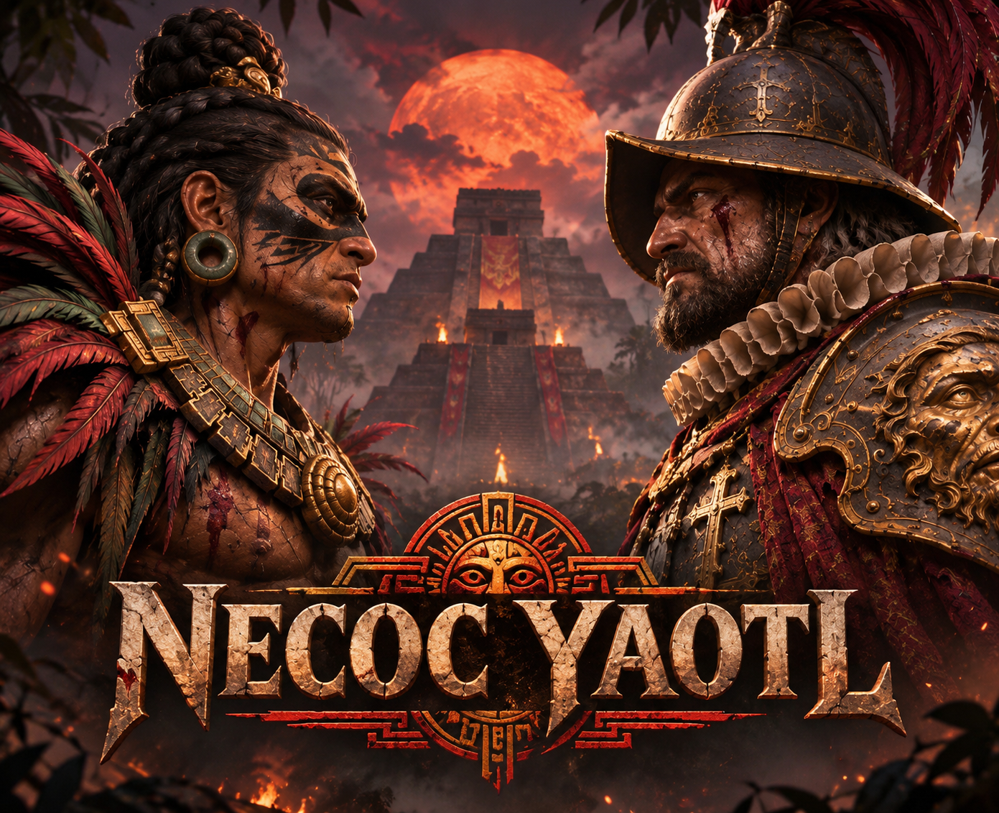

# NECOC YAOTL

**A dark fantasy action game inspired by Mexica civilization.**

*The first-ever video game project by the solo developer behind Yaxché Industries.*

[**Development Journal**](NecocYaotl_DevLog_EN_Final.md) · [**Combat Architecture**](NecocYaotl_Combat_Architecture_Plan_DevLog.md)

---

## A First Step Into Game Development

Necoc Yaotl was created entirely from scratch during the **Epic AI MegaJam 2026**. It is my first video game development project and the first project of **Yaxché Industries** — the beginning of my transition from data engineering and AI engineering into game development.

Over a roughly four-day competition window, I directed the creative vision, made the artistic and technical decisions, tested the game, and coordinated AI-assisted production. This is a playable prototype, not a finished commercial game.

The game asks a central question:

**Can the cycle of violence truly be broken by resorting to violence once again?**

Inspired by Mexica civilization, the prototype explores a dark fantasy world of conquest, resistance, and the weight of choosing to fight.

---

## Development Documentation

Explore the development process of Necoc Yaotl, from its initial planning to the final MegaJam submission.

### Development Journal

The complete milestone-by-milestone story of the project, documenting creative decisions, technical challenges, experiments, mistakes, revisions, and lessons learned throughout development.

**[Read the Development Journal](NecocYaotl_DevLog_EN_Final.md)**

### Combat Architecture — Director's Cut

The original Rally-first combat architecture planning document, including proposed systems, responsibilities, technical contracts, diagrams, and validation criteria.

This document represents the architectural planning stage, not a claim that every proposed system was implemented.

**[Explore the Combat Architecture](NecocYaotl_Combat_Architecture_Plan_DevLog.md)**

---

## Gameplay Recordings

These recordings document early gameplay experiments and technical tests conducted during the Epic AI MegaJam 2026.

Both videos feature Manny, Unreal Engine's temporary mannequin, before the integration of our custom Mexica warrior.

<table>
<tr>
<td width="50%" align="center">

**[01 — Early Combat & Level Testing](https://www.youtube.com/watch?v=uFavi_km9p0)**

Initial combat mechanics, enemy encounters, and level exploration before the boss area was introduced.

</td>
<td width="50%" align="center">

**[02 — Early Combat & Boss Area Testing](https://www.youtube.com/watch?v=csW0na7OAFI)**

Early gameplay featuring the boss-area entrance and its interactive E-key activation.

</td>
</tr>
</table>

---

## Visual Development

Screenshots captured during the Epic AI MegaJam 2026 document the challenges, experiments, and progress behind the development of Necoc Yaotl.

These images are organized by subject rather than chronology, preserving their original filenames and dates.

### Development Galleries

#### Character Development
Character generation, rigging, skinning, mesh deformation, accessories, and integration into Unreal Engine.

**[Explore Character Development](Character%20Development/)**

#### Environment Development
Level grayboxing, temple construction, environmental assets, materials, lighting, and visual experimentation.

**[Explore Environment Development](Enviroment%20Development/)**

#### Combat & Gameplay
Combat experiments, gameplay mechanics, animation tests, interactions, and visual debugging.

**[Explore Combat & Gameplay](Combat%20%26%20Gameplay/)**

---

## How the Game Was Made

Necoc Yaotl was developed by a solo developer, combining human creative direction with AI-assisted tools and workflows.

### Development Tools

- **Unreal Engine 5.8** — Game development, combat systems, environments, and integration.
- **Blender** — 3D asset preparation, rigging, skinning, animation experiments, and materials.
- **DeepSeek via OpenCode** — Primary AI implementation assistant, supporting programming, technical integration, automation, and debugging.
- **Codex (OpenAI)** — Additional implementation, integration, and final stabilization.
- **ChatGPT (OpenAI)** — Planning, technical analysis, documentation, and development coordination.
- **Quaternius** — Animation libraries explored and adapted during development.
- **WeLoveIndies** — Sound resources used during the jam.

### Special Thanks

**Grok (xAI)**

For its exceptional support in researching, designing, and refining the Rally-first combat architecture through extensive technical analysis and multiple iterations.

**Tripo AI**

For its invaluable contribution to generating 3D characters, enemies, accessories, and environmental assets that helped bring Necoc Yaotl to life. These assets were subsequently prepared and adapted using Blender.

Their contributions played an essential role in making this first game development project possible within the limited timeframe of the Epic AI MegaJam 2026.

All creative direction, artistic decisions, gameplay testing, and final approvals remained under human control.

---

**NECOC YAOTL · YAXCHÉ INDUSTRIES**

*Epic AI MegaJam 2026 · First Video Game Project · Solo Developer*

